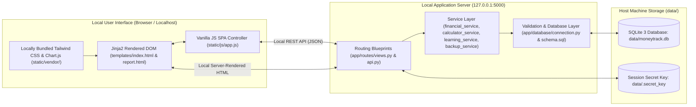
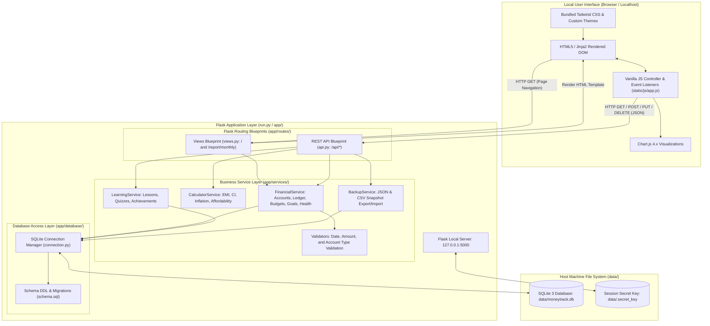
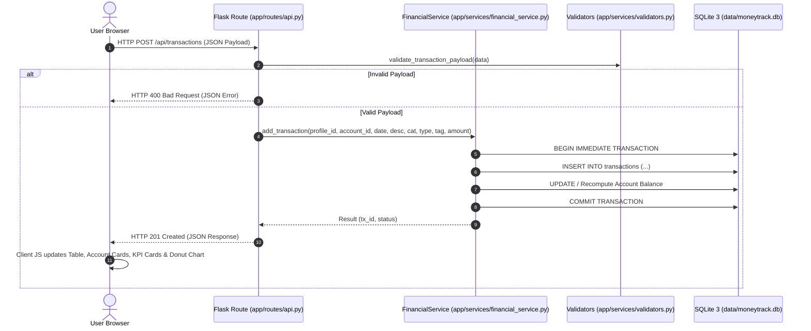
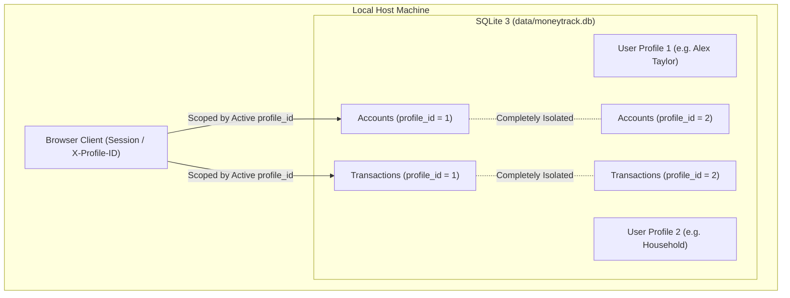
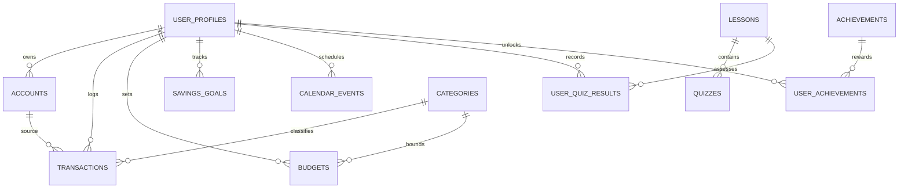

# MoneyTrack — System Architecture Document

**Document Version:** 1.0.0  
**Status:** Approved Architectural Specification  
**Classification:** Core System Architecture  
**Application Name:** MoneyTrack — Smart Financial Literacy and Budget Planner for Public  
**Core Constraint:** 100% Offline and Privacy-First  
**Target Repository Path:** `doc/ARCHITECTURE.md`  
**Current Release Version:** `v0.8.1-beta` 

---

## 1. Architecture Overview

### 1.1 Architectural Context
MoneyTrack is an air-gapped, privacy-first personal financial management and education platform. The application is implemented as a full-stack local web application powered by **Python 3.10+, Flask 3.x, SQLite 3, Jinja2, locally bundled Tailwind CSS, Vanilla JavaScript (ES6+), and Chart.js 4.x**.



### 1.2 System Purpose & Operational Boundary
MoneyTrack's primary architectural imperative is **absolute local data custody**: all user records, multi-account ledgers, budgets, savings goals, calendar events, and analytical projections are computed and persisted strictly on the user's physical machine. The system executes zero external HTTP requests, integrates zero cloud databases, and incorporates zero telemetry or third-party tracking scripts.

---

## 2. Architectural Principles

The architecture adheres to seven non-negotiable design principles:

1. **Strict Layered Separation of Concerns:**
   $$\textbf{Frontend} \longrightarrow \textbf{Flask Routes} \longrightarrow \textbf{Services} \longrightarrow \textbf{Algorithms} \longrightarrow \textbf{Database Layer} \longrightarrow \textbf{SQLite}$$
   - **Templates (`templates/`):** Handle presentation only. Zero business logic or database queries.
   - **Routes (`app/routes/`):** Handle HTTP transport, request deserialization, parameter validation, and response serialization.
   - **Services (`app/services/`):** Coordinate business workflows, manage transaction boundaries, and orchestrate multi-entity data models.
   - **Algorithms (`calculator_service.py` & `financial_service.py`):** Execute deterministic financial calculations as pure, stateless functions.
   - **Database Layer (`app/database/`):** Centralize all SQL queries, connection lifecycles, and relational mappings.
2. **100% Offline Air-Gap Operation:** The application runtime never stalls or throws errors without network connectivity. All assets (CSS, JS, fonts, icons, Python dependencies) reside locally in `static/vendor/` and `vendor/`.
3. **Zero-Knowledge Data Privacy:** No user data or analytics telemetry ever leaves the host machine. There is no remote authentication server, cloud sync, or external logging.
4. **Deterministic Financial Precision:** Financial arithmetic avoids IEEE 754 floating-point precision drift. All monetary quantities are handled as integer paise ($1\text{ INR} = 100\text{ paise}$, `amount_paise INTEGER`).
5. **ACID Transactional Integrity:** All multi-entity modifications (e.g. logging a transaction and updating goal reserves or balances) execute within atomic database transactions.
6. **No AI/ML Dependencies:** Recommendations, financial health scoring, and affordability checks are computed via transparent, verifiable, rule-based algorithms.
7. **Design Fidelity Preservation:** The presentation layer strictly preserves the visual aesthetics, layouts, component structures, and color palettes established in the authoritative visual prototype (`sample_ui/MoneyTrack Financial Planner(DEMO).html` and `doc/references/moneytrack-ui-reference.html`).

---

## 3. Technology Stack and Responsibilities

| Technology | Layer | Runtime Role & Responsibility |
| :--- | :--- | :--- |
| **Python 3.10+** | Backend Runtime | Core application execution environment, business logic processing, and local thread management. |
| **Flask 3.x** | Web Framework | Lightweight WSGI web server, HTTP routing, request/response lifecycle, and blueprint modularization (`app/`). |
| **SQLite 3** | Persistence Layer | Embedded relational database with Write-Ahead Logging (WAL) and foreign key enforcement (`data/moneytrack.db`). |
| **Jinja2** | Template Engine | Server-side HTML generation, template rendering, and auto-escaped XSS prevention (`templates/index.html`, `templates/report.html`). |
| **Tailwind CSS (Local)** | Styling System | Pre-packaged, locally bundled utility CSS runtime (`static/vendor/tailwind.min.js` + `static/css/custom.css`). |
| **Vanilla JavaScript (ES6+)**| Client Interaction | Client-side DOM event management, async API fetch requests, modal interactions, and reactive calculations (`static/js/app.js`). |
| **Chart.js 4.x (Local)** | Data Visualization | Locally bundled canvas charting engine for category spending donuts and analytics (`static/vendor/chart.umd.min.js`). |
| **Bundled Offline Packages**| Dependency Cache | Pre-packaged local Python distributions in `vendor/` ensuring air-gapped installation without external pip access. |

---

## 4. High-Level Architecture Diagram



---

## 5. Application Request Lifecycle



---

## 6. Frontend Architecture

### 6.1 Server-Rendered Views & Single-Page Application
The frontend is rendered via Flask Jinja2 templates:
- **`templates/index.html`:** The primary Single-Page Application containing all 9 core views, account management modal, transaction modal, goal modal, and password authentication dialogs.
- **`templates/report.html`:** A dedicated, clean, printer-ready and PDF-exportable monthly financial statement.

### 6.2 Client-Side JavaScript Architecture (`static/js/app.js`)
Client scripts operate as a cohesive reactive singleton controller:
1. **State Manager:** Manages active user profile, currency formatting, accounts list, and filters.
2. **View Navigation:** Handles smooth switching between the 9 views:
   1. Dashboard (`#view-dashboard`)
   2. Money & Accounts (`#view-money`)
   3. Savings Goals (`#view-goals`)
   4. Simulator & Affordability (`#view-simulator`)
   5. Future Money Calendar (`#view-calendar`)
   6. Analytics & Trends (`#view-analytics`)
   7. Financial Literacy & Quizzes (`#view-learn`)
   8. Financial Calculators (`#view-tools`)
   9. Settings & Data Management (`#view-settings`)
3. **Multi-Account Controls:** Renders account cards, handles account creation/updates, and updates asset vs liability balances.
4. **Modal Dialogs:** Handles accessible opening and closing of modals for transactions, accounts, goals, and passwords.
5. **Interactive Calculators:** Reactive listeners for instant EMI, Compound Interest, and Inflation calculations.

---

## 7. Backend Architecture

### 7.1 Python Application Package (`app/`)
```
app/
├── __init__.py                 # Flask application factory (create_app), secret key, error handlers
├── database/
│   ├── connection.py           # SQLite connection pool, WAL mode, foreign keys, migrations, seeders
│   └── schema.sql              # 11-table relational schema with integer paise currency fields
├── routes/
│   ├── api.py                  # REST API Blueprint (/api/*, /api/dashboard, /api/diagnostics, /api/accounts/summary)
│   └── views.py                # View Blueprint (/ and /report/monthly)
└── services/
    ├── financial_service.py    # Multi-account balances, ledger, budgets, goals, health score, insights, alerts, diagnostics
    ├── calculator_service.py   # EMI, compound interest, inflation, purchase affordability engines
    ├── learning_service.py     # Lessons curriculum, interactive quizzes, achievements
    ├── backup_service.py       # JSON backup export/import and CSV statement export
    └── validators.py           # Input sanitization and data validation
```

### 7.2 Application Entry Point (`run.py`)
The local execution entry point `run.py` boots the Flask application on `http://127.0.0.1:5000`:
- Sets environment variables and ensures `vendor/` is in `sys.path`.
- Calls `create_app()` which runs database initialization and non-destructive migrations.
- Starts the local WSGI server with thread support.

### 7.3 Dashboard Analytics, Diagnostics & Alerting Architecture
- **Account-Scoped Analytics:** `/api/dashboard?account_id=X` isolates KPI totals, category breakdowns, budgets, and health scores to the specified account, defaulting to the profile's primary account.
- **Rule-Based Insights Engine:** `FinancialService.generate_spending_insights()` executes transparent comparative analysis (month-over-month category variance, large unusual spends) without external AI models or cloud dependencies.
- **Real-Time Financial Alerts:** `FinancialService.get_financial_alerts()` evaluates 6 deterministic conditions (budget exceeded, threshold warning, low balance < ₹1,000, credit card balance, upcoming bills) and deduplicates alerts.
- **Live Integrity Diagnostics:** `FinancialService.run_system_diagnostics()` executes 5 database integrity tests: Ledger calculation consistency, Transaction references, Category budget bounds, Account configuration, and SQLite WAL/FK PRAGMA status.
- **Background Tab Notifications:** The client uses `window.Notification` when the tab is hidden (`document.hidden`), title flashing, and an in-app toast stack (`showToast()`) with zero external notification services.

---

## 8. Multi-Account Architecture & Balance Calculations

MoneyTrack supports **6 distinct account types** partitioned into Assets and Liabilities:

| Account Type | Classification | Balance Formula |
| :--- | :--- | :--- |
| `savings` | Asset | $\text{Initial Balance} + \text{Income} - \text{Expenses} + \text{Inbound Transfers} - \text{Outbound Transfers}$ |
| `current` | Asset | $\text{Initial Balance} + \text{Income} - \text{Expenses} + \text{Inbound Transfers} - \text{Outbound Transfers}$ |
| `cash` | Asset | $\text{Initial Balance} + \text{Income} - \text{Expenses} + \text{Inbound Transfers} - \text{Outbound Transfers}$ |
| `wallet` | Asset | $\text{Initial Balance} + \text{Income} - \text{Expenses} + \text{Inbound Transfers} - \text{Outbound Transfers}$ |
| `investment` | Asset | $\text{Initial Balance} + \text{Income} - \text{Expenses} + \text{Inbound Transfers} - \text{Outbound Transfers}$ |
| `credit_card`| Liability | $\text{Initial Balance} + \text{Expenses (Charges)} - \text{Inflows (Payments/Credits)}$ |

### Cascade Deletion Safety
Transactions reference accounts with `ON DELETE SET NULL`:
```sql
FOREIGN KEY (account_id) REFERENCES accounts(id) ON DELETE SET NULL,
FOREIGN KEY (destination_account_id) REFERENCES accounts(id) ON DELETE SET NULL
```
When an account is deleted, all past transactions remain intact in the historical ledger.

---

## 9. Local Multi-User Authentication & Data Isolation

MoneyTrack supports multi-profile isolation with local password verification:



- **Password Hashing:** Passwords are hashed using Werkzeug's secure key derivation (`generate_password_hash`, `check_password_hash`).
- **Data Scoping:** Every financial query in `FinancialService` strictly filters by `profile_id = ?`.
- **Session Security:** Cookies use `HttpOnly` and `SameSite=Lax`.

---

## 10. Financial Algorithms

### 10.1 Reducing-Balance Loan EMI
$$r = \frac{\text{Annual Rate}}{12 \times 100}, \quad EMI = \begin{cases} \frac{P \cdot r \cdot (1+r)^N}{(1+r)^N - 1} & \text{if } r > 0 \\ \frac{P}{N} & \text{if } r = 0 \end{cases}$$
$$\text{Total Interest} = (EMI \times N) - P$$

### 10.2 Compound Interest Projections
$$A = P \cdot \left(1 + \frac{r}{100 \cdot n}\right)^{n \cdot t}, \quad \text{Interest Earned} = A - P$$

### 10.3 Inflation & Purchasing Power Erosion
$$FV = PV \cdot \left(1 + \frac{i}{100}\right)^t$$

### 10.4 3-Pillar Financial Health Score ($0–100$)
$$\text{Score} = \text{Savings Rate (40\%)} + \text{Budget Discipline (35\%)} + \text{Emergency Runway (25\%)}$$
- If an account has no income or transactions recorded, the score is strictly initialized to **0 ("Getting Started")**.

---

## 11. Database Schema (11 Relational Tables)



1. **`user_profiles`:** User identity, password hash, currency, active status.
2. **`accounts`:** Financial accounts across 6 types, initial balance, color, icon, default flag.
3. **`categories`:** Income and expense categories with color and icon tags.
4. **`transactions`:** Core ledger with `amount_paise`, source and destination accounts, category, type, and necessity tags.
5. **`budgets`:** Monthly category spending ceilings (`UNIQUE(profile_id, category_id, month_year)`).
6. **`savings_goals`:** Targets, current deposits, deadlines, status.
7. **`calendar_events`:** Recurring bills, frequencies (`once`, `weekly`, `monthly`, `yearly`), status.
8. **`lessons`:** Structured financial education curriculum.
9. **`quizzes`:** Multiple-choice quiz questions with answer options JSON and explanations.
10. **`user_quiz_results`:** Historical quiz scores and timestamps.
11. **`achievements` & `user_achievements`:** Gamified badges and unlock timestamps.

---

## 12. Verification & Testing

The application architecture is verified by a 57-test automated test suite across 8 modules:
- `tests/test_accounts.py` (8 tests)
- `tests/test_api.py` (8 tests)
- `tests/test_calculators.py` (3 tests)
- `tests/test_dashboard_analytics_and_alerts.py` (7 tests)
- `tests/test_e2e_workflows.py` (5 tests)
- `tests/test_financial_service.py` (6 tests)
- `tests/test_security_and_integrity.py` (12 tests)
- `tests/test_username_auth.py` (8 tests)

Running `python3 -m unittest discover -s tests` confirms **57 tests ran and 57 passed (100% pass rate)**.
