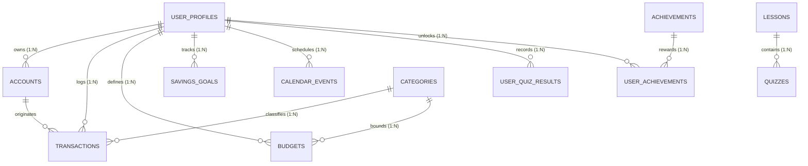

# MoneyTrack — Database Architecture & Schema Specification

**Document Version:** 1.0.0  
**Status:** Approved Technical Specification  
**Classification:** Database Architecture & Schema Reference  
**Project:** MoneyTrack — Smart Financial Literacy and Budget Planner for Public  
**Core Constraint:** 100% Offline and Privacy-First  
**Target Repository Path:** `doc/DATABASE.md`  
**Current Release Version:** `v0.2.1-beta` (Git Commit: `c37a834`, Target: `v1.0.0 Stable`)  

---

## 1. Database Overview

### 1.1 Physical Reality & Ground Truth
MoneyTrack utilizes an embedded **SQLite 3 relational database** stored locally on disk at `data/moneytrack.db`. The relational schema definition resides at `app/database/schema.sql` and connection lifecycle management is implemented in `app/database/connection.py`.

### 1.2 Database Engine Selection Rationale: SQLite 3
SQLite 3 was chosen as the persistence engine because it fulfills the core product guarantees:
1. **Zero Server Dependency:** Runs embedded within the Python/Flask process; requires no separate background database daemon or service.
2. **100% Offline Sovereignty:** All data is held in a single self-contained local binary file on the user's hard drive.
3. **Full ACID Compliance:** Supports atomic transactions (`BEGIN IMMEDIATE`, `COMMIT`, `ROLLBACK`), guaranteeing financial ledger consistency.
4. **Negligible Footprint:** Negligible memory overhead ($< 2\text{MB}$) and sub-millisecond query execution.
5. **Cross-Platform Portability:** A SQLite file created on Linux functions identically when moved to Windows or macOS without transformation.

---

## 2. SQLite Configuration & PRAGMAs

MoneyTrack mandates strict PRAGMA configurations on every connection to enforce relational integrity, write concurrency, and lock contention handling:

```python
# app/database/connection.py
import sqlite3

def get_db_connection(db_path=None):
    """Returns an isolated SQLite connection with foreign keys enabled and Row factory."""
    path = get_db_path(db_path)
    conn = sqlite3.connect(path, timeout=10.0)
    conn.row_factory = sqlite3.Row
    conn.execute("PRAGMA foreign_keys = ON;")
    conn.execute("PRAGMA journal_mode = WAL;")
    return conn
```

### PRAGMA Configuration Rationale

| PRAGMA Directive | Setting | Architectural Purpose |
| :--- | :--- | :--- |
| **`PRAGMA foreign_keys`** | `ON` | **Mandatory Integrity:** SQLite disables foreign key checks by default. Enabling this enforces relational cascades and rejects orphaned transaction records. |
| **`PRAGMA journal_mode`** | `WAL` | **Concurrency Optimization:** Write-Ahead Logging allows readers to access the database without being blocked by write transactions. |
| **`PRAGMA timeout`** | `10.0` | **Contention Guard:** Waits up to 10 seconds if database locks occur before raising `OperationalError`. |

---

## 3. Database File Locations

- **Active SQLite Database:** `data/moneytrack.db`
- **Application Session Secret:** `data/.secret_key` (Cryptographically generated 32-byte secret with restricted 0600 file permissions).
- **WAL Journal Files:** `data/moneytrack.db-wal` and `data/moneytrack.db-shm` (automatically managed by SQLite runtime; excluded via `.gitignore`).

---

## 4. Complete Table Inventory (11 Relational Tables)

The MoneyTrack database schema models the entire personal finance, multi-account, and financial literacy curriculum lifecycle across 11 tables:

| Table Name | Category | Primary Purpose | Cardinality Proxy |
| :--- | :--- | :--- | :--- |
| **`user_profiles`** | Identity / Sandbox | User identity, password hash, currency, active profile state. | 1 to 10 profiles |
| **`accounts`** | Multi-Account Engine | Financial accounts across 6 types (Assets vs Liabilities). | 2 to 20 accounts |
| **`categories`** | Taxonomy | Income, expense, and transfer category metadata. | 7 to 30 categories |
| **`transactions`** | Core Ledger | Double-entry financial records in integer paise. | $10^2$ to $10^5$ rows |
| **`budgets`** | Financial Control | Monthly spending ceilings per category. | 5 to 30 limits/month |
| **`savings_goals`** | Wealth Building | Target amounts, accumulated savings, and deadlines. | 1 to 20 goals |
| **`calendar_events`**| Cash Flow Planning | Scheduled recurring bills and income obligations. | 2 to 50 events/month |
| **`lessons`** | Educational Curriculum | Micro-lessons on budgeting, compound growth, and inflation. | 3 to 20 lessons |
| **`quizzes`** | Interactive Testing | Multiple-choice quiz questions with feedback. | 10 to 100 questions |
| **`user_quiz_results`**| Educational Progress | User quiz scores and completion timestamps. | 1 to 100 results |
| **`achievements`** & **`user_achievements`** | Gamification | Milestone badge catalog and user unlock records. | 4 to 20 badges |

---

## 5. Complete DDL Specification (`app/database/schema.sql`)

```sql
PRAGMA foreign_keys = ON;

-- 1. Local User Profiles (Multi-profile ready)
CREATE TABLE IF NOT EXISTS user_profiles (
    id INTEGER PRIMARY KEY AUTOINCREMENT,
    name TEXT NOT NULL UNIQUE,
    password_hash TEXT,
    currency TEXT NOT NULL DEFAULT '₹',
    status TEXT NOT NULL DEFAULT 'Pro Planner',
    is_active INTEGER NOT NULL DEFAULT 1,
    created_at TIMESTAMP DEFAULT CURRENT_TIMESTAMP
);

-- 2. Financial Accounts (Multi-Account Support with Types)
CREATE TABLE IF NOT EXISTS accounts (
    id INTEGER PRIMARY KEY AUTOINCREMENT,
    profile_id INTEGER NOT NULL,
    name TEXT NOT NULL,
    account_type TEXT NOT NULL CHECK(account_type IN ('savings', 'current', 'cash', 'credit_card', 'wallet', 'investment')),
    initial_balance_paise INTEGER NOT NULL DEFAULT 0,
    color TEXT NOT NULL DEFAULT '#3b82f6',
    icon TEXT NOT NULL DEFAULT 'bank',
    is_default INTEGER NOT NULL DEFAULT 0,
    created_at TIMESTAMP DEFAULT CURRENT_TIMESTAMP,
    FOREIGN KEY (profile_id) REFERENCES user_profiles(id) ON DELETE CASCADE
);

-- 3. Financial Categories
CREATE TABLE IF NOT EXISTS categories (
    id INTEGER PRIMARY KEY AUTOINCREMENT,
    name TEXT UNIQUE NOT NULL,
    type TEXT NOT NULL CHECK(type IN ('income', 'expense', 'both')),
    color TEXT NOT NULL DEFAULT '#3b82f6',
    icon TEXT
);

-- 4. Core Financial Transactions Ledger
CREATE TABLE IF NOT EXISTS transactions (
    id INTEGER PRIMARY KEY AUTOINCREMENT,
    profile_id INTEGER NOT NULL,
    account_id INTEGER,
    destination_account_id INTEGER,
    date TEXT NOT NULL,
    description TEXT NOT NULL,
    category_id INTEGER NOT NULL,
    type TEXT NOT NULL CHECK(type IN ('income', 'expense', 'transfer')),
    type_tag TEXT NOT NULL DEFAULT 'necessary' CHECK(type_tag IN ('necessary', 'optional', 'savings', 'debt')),
    amount_paise INTEGER NOT NULL CHECK(amount_paise > 0),
    created_at TIMESTAMP DEFAULT CURRENT_TIMESTAMP,
    FOREIGN KEY (profile_id) REFERENCES user_profiles(id) ON DELETE CASCADE,
    FOREIGN KEY (account_id) REFERENCES accounts(id) ON DELETE SET NULL,
    FOREIGN KEY (destination_account_id) REFERENCES accounts(id) ON DELETE SET NULL,
    FOREIGN KEY (category_id) REFERENCES categories(id) ON DELETE RESTRICT
);

-- 5. Category Monthly Budgets
CREATE TABLE IF NOT EXISTS budgets (
    id INTEGER PRIMARY KEY AUTOINCREMENT,
    profile_id INTEGER NOT NULL,
    category_id INTEGER NOT NULL,
    monthly_limit_paise INTEGER NOT NULL CHECK(monthly_limit_paise > 0),
    month_year TEXT NOT NULL, -- Format: YYYY-MM
    created_at TIMESTAMP DEFAULT CURRENT_TIMESTAMP,
    FOREIGN KEY (profile_id) REFERENCES user_profiles(id) ON DELETE CASCADE,
    FOREIGN KEY (category_id) REFERENCES categories(id) ON DELETE CASCADE,
    UNIQUE(profile_id, category_id, month_year)
);

-- 6. Savings Goals
CREATE TABLE IF NOT EXISTS savings_goals (
    id INTEGER PRIMARY KEY AUTOINCREMENT,
    profile_id INTEGER NOT NULL,
    name TEXT NOT NULL,
    target_amount_paise INTEGER NOT NULL CHECK(target_amount_paise > 0),
    current_amount_paise INTEGER NOT NULL DEFAULT 0 CHECK(current_amount_paise >= 0),
    target_date TEXT NOT NULL,
    status TEXT NOT NULL DEFAULT 'active' CHECK(status IN ('active', 'completed', 'archived')),
    created_at TIMESTAMP DEFAULT CURRENT_TIMESTAMP,
    FOREIGN KEY (profile_id) REFERENCES user_profiles(id) ON DELETE CASCADE
);

-- 7. Future Money Calendar & Recurring Cashflow Events
CREATE TABLE IF NOT EXISTS calendar_events (
    id INTEGER PRIMARY KEY AUTOINCREMENT,
    profile_id INTEGER NOT NULL,
    title TEXT NOT NULL,
    amount_paise INTEGER NOT NULL CHECK(amount_paise > 0),
    type TEXT NOT NULL CHECK(type IN ('income', 'expense')),
    due_date TEXT NOT NULL, -- Format: YYYY-MM-DD
    frequency TEXT NOT NULL DEFAULT 'monthly' CHECK(frequency IN ('once', 'weekly', 'monthly', 'yearly')),
    status TEXT NOT NULL DEFAULT 'scheduled' CHECK(status IN ('scheduled', 'paid', 'cancelled')),
    created_at TIMESTAMP DEFAULT CURRENT_TIMESTAMP,
    FOREIGN KEY (profile_id) REFERENCES user_profiles(id) ON DELETE CASCADE
);

-- 8. Educational Lessons Curriculum
CREATE TABLE IF NOT EXISTS lessons (
    id INTEGER PRIMARY KEY AUTOINCREMENT,
    slug TEXT UNIQUE NOT NULL,
    title TEXT NOT NULL,
    difficulty TEXT NOT NULL CHECK(difficulty IN ('Beginner', 'Intermediate', 'Essential', 'Advanced')),
    read_time TEXT NOT NULL,
    summary TEXT NOT NULL,
    content TEXT NOT NULL,
    order_index INTEGER NOT NULL DEFAULT 0
);

-- 9. Interactive Quizzes
CREATE TABLE IF NOT EXISTS quizzes (
    id INTEGER PRIMARY KEY AUTOINCREMENT,
    lesson_id INTEGER NOT NULL,
    question TEXT NOT NULL,
    options_json TEXT NOT NULL, -- JSON array of strings
    correct_index INTEGER NOT NULL CHECK(correct_index >= 0 AND correct_index <= 3),
    explanation TEXT NOT NULL,
    FOREIGN KEY (lesson_id) REFERENCES lessons(id) ON DELETE CASCADE
);

-- 10. User Learning & Quiz Performance
CREATE TABLE IF NOT EXISTS user_quiz_results (
    id INTEGER PRIMARY KEY AUTOINCREMENT,
    profile_id INTEGER NOT NULL,
    lesson_id INTEGER NOT NULL,
    score INTEGER NOT NULL,
    total INTEGER NOT NULL,
    completed_at TIMESTAMP DEFAULT CURRENT_TIMESTAMP,
    FOREIGN KEY (profile_id) REFERENCES user_profiles(id) ON DELETE CASCADE,
    FOREIGN KEY (lesson_id) REFERENCES lessons(id) ON DELETE CASCADE
);

-- 11. Achievements Catalog & User Unlocked Badges
CREATE TABLE IF NOT EXISTS achievements (
    id INTEGER PRIMARY KEY AUTOINCREMENT,
    code TEXT UNIQUE NOT NULL,
    title TEXT NOT NULL,
    description TEXT NOT NULL,
    icon TEXT NOT NULL DEFAULT 'star'
);

CREATE TABLE IF NOT EXISTS user_achievements (
    id INTEGER PRIMARY KEY AUTOINCREMENT,
    profile_id INTEGER NOT NULL,
    achievement_id INTEGER NOT NULL,
    unlocked_at TIMESTAMP DEFAULT CURRENT_TIMESTAMP,
    FOREIGN KEY (profile_id) REFERENCES user_profiles(id) ON DELETE CASCADE,
    FOREIGN KEY (achievement_id) REFERENCES achievements(id) ON DELETE CASCADE,
    UNIQUE(profile_id, achievement_id)
);

-- Performance Indexes
CREATE INDEX IF NOT EXISTS idx_tx_profile_date ON transactions(profile_id, date);
CREATE INDEX IF NOT EXISTS idx_tx_category ON transactions(category_id);
CREATE INDEX IF NOT EXISTS idx_budgets_lookup ON budgets(profile_id, month_year);
CREATE INDEX IF NOT EXISTS idx_goals_profile ON savings_goals(profile_id);
CREATE INDEX IF NOT EXISTS idx_calendar_date ON calendar_events(profile_id, due_date);
```

---

## 6. Entity-Relationship Model



---

## 7. Multi-Account Balance Logic (Assets vs Liabilities)

The database schema supports double-entry balance calculations separating Assets and Liabilities:

### 1. Asset Accounts (`savings`, `current`, `cash`, `wallet`, `investment`)
$$\text{Current Balance} = \text{initial\_balance\_paise} + \sum \text{Income} - \sum \text{Expense} + \sum \text{Inbound Transfers} - \sum \text{Outbound Transfers}$$

### 2. Liability Accounts (`credit_card`)
$$\text{Current Balance} = \text{initial\_balance\_paise} + \sum \text{Expenses (Charges)} - \sum \text{Inflows (Payments/Credits)}$$

### Cascade Safety
Account deletion utilizes `ON DELETE SET NULL`:
```sql
FOREIGN KEY (account_id) REFERENCES accounts(id) ON DELETE SET NULL
```
Transactions remain preserved in the ledger history even if an account is closed or deleted.

---

## 8. Monetary Storage Standard: Integer Paise

$$\textbf{RULE: Never store currency values as floating-point numbers.}$$

To eliminate IEEE 754 precision drift, MoneyTrack strictly stores all monetary values in minor units (**integer paise**, where $₹1 = 100\text{ paise}$):
- `amount_paise INTEGER NOT NULL CHECK(amount_paise > 0)`
- `initial_balance_paise INTEGER NOT NULL DEFAULT 0`
- `monthly_limit_paise INTEGER NOT NULL CHECK(monthly_limit_paise > 0)`
- `target_amount_paise INTEGER NOT NULL CHECK(target_amount_paise > 0)`
- `current_amount_paise INTEGER NOT NULL DEFAULT 0`

Conversions between display Rupees ($₹$) and stored paise occur strictly at the presentation boundary in `app.js` and Jinja templates.

---

## 9. Non-Destructive Migrations & Seed Manager

The database initialization routine in `app/database/connection.py` provides automated, non-destructive column migrations and seed management:
- Automatically detects missing columns (such as `account_id`, `destination_account_id` in `transactions`, and `password_hash` in `user_profiles`) and applies `ALTER TABLE` statements without data loss.
- Pre-seeds standard reference categories (`Food & Dining`, `Transport`, `Shopping`, `Bills & Utilities`, `Salary`, `Other`, `Transfer`).
- Provisions the initial educational lessons, quiz questions, and achievements catalog.