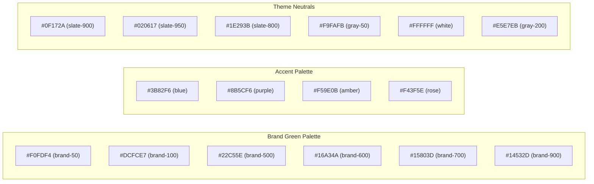
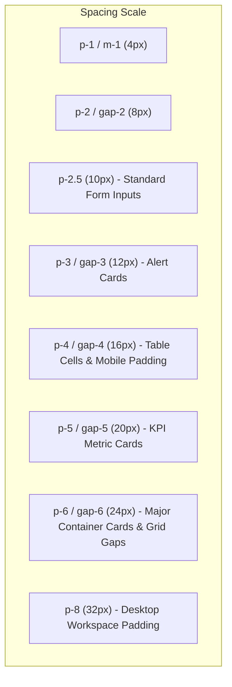
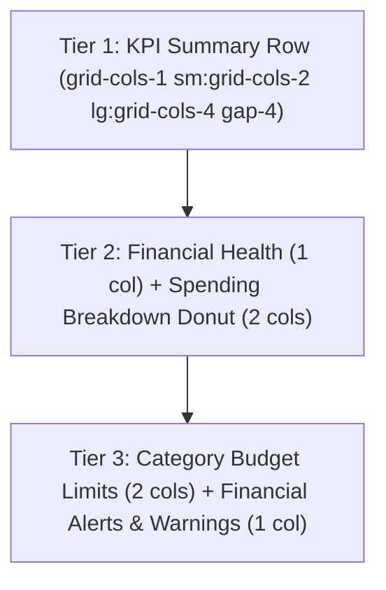
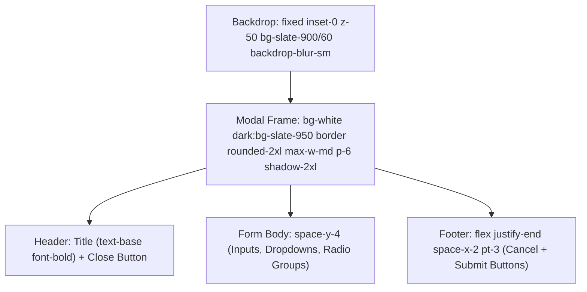

# MoneyTrack — UI/UX Design System Specification

**Document Version:** 1.0.0  
**Status:** Approved Visual Specification & Design Standard  
**Classification:** Design Authority & UI Guidelines  
**Project:** MoneyTrack — Smart Financial Literacy and Budget Planner  
**Target Repository Path:** `doc/DESIGN.md`  
**Primary Design Reference File:** `sample_ui/MoneyTrack Financial Planner(DEMO).html` (Reference copy: `doc/references/moneytrack-ui-reference.html`)  

---

## 1. Design Philosophy

MoneyTrack is designed as a **calm, empowering, privacy-respecting financial cockpit**. Personal budgeting and financial education can be intimidating for beginners; therefore, the interface deliberately eliminates visual clutter, aggressive advertising banners, and complex accounting jargon.

### Core Visual Principles
1. **Clarity Over Novelty:** Every visual element serves a functional or educational purpose. UI components are clean, compact, and scannable.
2. **Deterministic Color Semantics:** Color is used functionally to communicate financial health:
   - **Brand Green:** Financial stability, positive balances, savings growth, completed goals, and safe budget margins.
   - **Accent Blue:** Information, educational guidance, compound growth metrics, and neutral trends.
   - **Accent Purple:** Long-term assets, emergency reserves, and essential foundational milestones.
   - **Accent Amber:** Warning thresholds, approaching budget limits ($90\%–100\%$), and cautionary cash flow runway.
   - **Accent Rose / Red:** Budget overruns ($>100\%$), expense outflows, depleted runway, and critical alerts.
3. **Calm, High-Contrast Theming:** Dark mode is the primary default, reducing eye strain during evening planning sessions. Light mode provides a clean, crisp, high-contrast alternative. Both themes comply strictly with accessibility contrast standards.
4. **Visible Offline Sovereignty:** The interface visibly assures the user of their absolute privacy through persistent offline indicators, zero remote loading spinners, and instant local interactivity.

---

## 2. Existing Visual Identity & Reference File Information

### 2.1 Reference File Identification
- **Primary Visual Reference Location:** `sample_ui/MoneyTrack Financial Planner(DEMO).html` (108,515 bytes, 1,438 lines of code).
- **Secondary / Archival Mirror Path:** `doc/references/moneytrack-ui-reference.html`.
- **Production Templates:** `templates/index.html` (single-page application) and `templates/report.html` (monthly statement report).
- **Authority Clause:** The owner-provided HTML prototype is the authoritative visual, layout, and component reference. All future frontend implementations (templates, styles, dynamic widgets) must visually match this reference.

### 2.2 Visual Archetype
- **Layout Model:** Fixed 256px (`w-64`) desktop sidebar + sticky top bar + centered max-width content container (`max-w-7xl`).
- **Surface Elevation:** Flat-to-subtle elevation. Components use delicate borders (`border-gray-200` in light mode, `border-slate-800` in dark mode) paired with soft drop shadows (`shadow-sm`, `shadow-md`, `shadow-2xl` for modals).
- **Corner Radii:** Soft, friendly rounding. Major containers and cards use `rounded-2xl` (16px); inputs, buttons, and alert boxes use `rounded-xl` (12px); filter tabs and badges use `rounded-lg` (8px).
- **Motion & Animations:** Minimal, functional micro-interactions. The only animation is a smooth 0.25s fade-in translation (`animate-fade-in` / `fadeIn 0.25s ease-out`) when switching views and 0.5s CSS width transitions on progress bars.

---

## 3. Color Palette & Theme Specifications

All colors are extracted directly from the reference HTML Tailwind configuration and stylesheet.



### 3.1 Color Specification Table

| Color Token | Hex Code | Tailwind Class Reference | Intended Usage |
| :--- | :--- | :--- | :--- |
| **brand-50** | `#F0FDF4` | `bg-brand-50` | Light theme subtle card highlights, active tab background. |
| **brand-100** | `#DCFCE7` | `bg-brand-100`, `text-brand-700` | Normal status badges, pill containers. |
| **brand-500** | `#22C55E` | `bg-brand-500`, `text-brand-500` | Progress bar active fills, gauge arcs, positive values. |
| **brand-600** | `#16A34A` | `bg-brand-600`, `hover:bg-brand-700` | **Primary CTA buttons**, active icons, brand logos. |
| **brand-700** | `#15803D` | `text-brand-700`, `bg-brand-700` | High-contrast green text in light theme. |
| **brand-900** | `#14532D` | `bg-brand-900`, `dark:bg-brand-900/50` | Dark theme badges, subtle green backdrops. |
| **accent-blue** | `#3B82F6` | `bg-accent-blue`, `text-accent-blue` | Savings rate metrics, compounding calculators. |
| **accent-purple** | `#8B5CF6` | `bg-accent-purple`, `text-accent-purple` | Emergency reserve metrics, literacy lessons. |
| **accent-amber** | `#F59E0B` | `bg-accent-amber`, `text-accent-amber` | Budget warning badges ($90\%–100\%$), caution states. |
| **accent-rose** | `#F43F5E` | `bg-accent-rose`, `text-accent-rose` | Expenses, over-budget alerts ($>100\%$), delete buttons. |

### 3.2 Dark Theme Neutral Tokens (Default)
- **Canvas / Body Background:** `#0F172A` (`bg-slate-900`)
- **Card, Sidebar & Modal Surface:** `#020617` (`bg-slate-950`)
- **Borders, Dividers & Outlines:** `#1E293B` (`border-slate-800`)
- **Primary Text:** `#F1F5F9` (`text-slate-100` / `text-white`)
- **Secondary / Subdued Text:** `#94A3B8` (`text-slate-400`)
- **Input Background:** `#0F172A` (`bg-slate-900`)

### 3.3 Light Theme Neutral Tokens
- **Canvas / Body Background:** `#F9FAFB` (`bg-gray-50`)
- **Card, Sidebar & Modal Surface:** `#FFFFFF` (`bg-white`)
- **Borders, Dividers & Outlines:** `#E5E7EB` (`border-gray-200`)
- **Primary Text:** `#0F172A` (`text-slate-900` / `text-slate-800`)
- **Secondary / Subdued Text:** `#64748B` (`text-slate-500`)
- **Input Background:** `#F9FAFB` (`bg-gray-50`)

### 3.4 Theme Switching Mechanism
Theme switching toggles the `.dark` class on the root `<html>` document. State is persisted in client storage (`state.theme = 'dark' | 'light'`) and applied synchronously prior to initial DOM paint to prevent screen flash.

---

## 4. Typography

### 4.1 Typeface Standard
MoneyTrack uses a clean, native sans-serif font stack prioritizing rapid cold boot and crisp legibility without remote font downloads:
```css
font-family: ui-sans-serif, system-ui, -apple-system, BlinkMacSystemFont, "Segoe UI", Roboto, "Helvetica Neue", Arial, sans-serif;
```

### 4.2 Type Scale Hierarchy

| Typographic Level | Size | Weight | Tracking | Classes | Example Use |
| :--- | :--- | :--- | :--- | :--- | :--- |
| **Display Metric** | 48px / 3rem | Black (900) | Tight (`-0.025em`) | `text-5xl font-black tracking-tight` | Financial Health Score (e.g. `78`) |
| **Page Heading** | 24px / 1.5rem | Bold (700) | Normal | `text-2xl font-bold` | "Money & Transactions", "Savings Goals" |
| **Metric Value** | 24px / 1.5rem | Bold (700) | Normal | `text-2xl font-bold` | "₹25,000", "₹18,400" (KPI cards) |
| **Section Heading** | 16px / 1rem | Bold (700) | Normal | `text-base font-bold` | Card titles, "Financial Health Score" |
| **Body Primary** | 14px / 0.875rem | Medium (500) | Normal | `text-sm font-medium` | Navigation menu items, descriptive paragraphs |
| **Body Secondary** | 12px / 0.75rem | Normal / Semibold | Normal | `text-xs font-semibold` / `text-xs text-slate-500` | Form labels, helper captions, table values |
| **Table Header / Micro**| 11px / 0.6875rem | Bold (700) | Wider (`0.05em`) | `text-[11px] font-bold uppercase tracking-wider` | Table columns (`DATE`, `AMOUNT`), category labels |
| **Micro Badge** | 10px / 0.625rem | Bold (700) | Normal | `text-[10px] font-bold uppercase` | "NORMAL", "WARNING", "ESSENTIAL" tags |

---

## 5. Spacing System

All spacing is calibrated to a strict 4px modular scale:



### Corner Radii Tokens
- **Large Container & Card Radius:** `rounded-2xl` (`16px` / `1rem`). Used for all dashboard cards, modal bodies, and table wrappers.
- **Form Input & Button Radius:** `rounded-xl` (`12px` / `0.75rem`). Used for text inputs, select dropdowns, primary buttons, and alert boxes.
- **Sub-Component / Tab Radius:** `rounded-lg` (`8px` / `0.5rem`). Used for filter tabs, table actions, and icon background boxes.
- **Pill / Badge Radius:** `rounded` (`4px`) or `rounded-full` (`9999px`). Used for category chips and status badges.

---

## 6. Layout Structure

### 6.1 Desktop Layout Architecture (Viewport $\ge 768\text{px}$)

```
+---------------------------------------------------------------------------------------------------+
|  [Sidebar: 256px / w-64]  |  [Sticky Top Header: px-6 py-4]                                       |
|  - Brand Logo & Title     |  - Active Page Breadcrumb     [Theme Toggle] [Profile: Alex Taylor]   |
|  - Nav Items (Dashboard,  |-----------------------------------------------------------------------|
|    Money, Goals, Sim,     |  [Main Content Container: max-w-7xl mx-auto p-8 space-y-8]           |
|    Calendar, Analytics,   |                                                                       |
|    Learn, Tools, Settings)|  <Active View Panel: .animate-fade-in>                                |
|                           |  - Row 1: KPI Summary Cards (grid-cols-4)                             |
|  - Offline Status Pill    |  - Row 2: Health Score (1 col) + Category Donut (2 cols)             |
|    "100% Offline Mode"    |  - Row 3: Category Budgets (2 cols) + Live Alerts (1 col)             |
+---------------------------------------------------------------------------------------------------+
```

### 6.2 Mobile Layout Architecture (Viewport $< 768\text{px}$)
- **Sticky Top Bar:** Brand logo + "MoneyTrack" title + Theme toggle button + Hamburger button.
- **Mobile Drawer:** Triggered by hamburger button; slides open as a full overlay (`fixed inset-0 z-50`) replicating the sidebar navigation.
- **Main Content:** Full-width container with `p-4 space-y-6`. Grids collapse cleanly to a single column (`grid-cols-1`).

---

## 7. Navigation System

### 7.1 Desktop Sidebar Specifications
- **Width:** `w-64` ($256\text{px}$), fixed height `h-screen`, sticky `sticky top-0`.
- **Surface:** `bg-white dark:bg-slate-950 border-r border-gray-200 dark:border-slate-800`.
- **Brand Block:** Height $72\text{px}$, padding `p-5`, featuring a $36\text{px} \times 36\text{px}$ (`w-9 h-9`) `bg-brand-600 rounded-xl` icon badge next to bold title `MoneyTrack` and micro subtitle `OFFLINE PLANNER`.
- **Navigation Buttons:** Full width `w-full flex items-center space-x-3 px-3 py-2.5 rounded-xl text-sm font-medium transition-all`:
  - **Active State:** `bg-brand-50 text-brand-700 dark:bg-brand-950/40 dark:text-brand-300 font-bold`.
  - **Inactive State:** `text-slate-600 dark:text-slate-400 hover:bg-gray-100 dark:hover:bg-slate-800/60`.
  - **Icons:** Standardized $20\text{px} \times 20\text{px}$ (`w-5 h-5`) SVG vector icons with `stroke-2`.

### 7.2 Sidebar Footer Status Card
Located at the bottom of the sidebar (`p-4 border-t border-gray-200 dark:border-slate-800`):
- Container: `bg-brand-50 dark:bg-slate-900/80 border border-brand-200 dark:border-brand-900/40 rounded-xl p-3`.
- Header: Green checkmark SVG + text `100% Offline Mode` (`font-semibold text-xs text-brand-700 dark:text-brand-400`).
- Caption: `All data is stored locally in your browser storage.` (`text-[11px] text-slate-500 dark:text-slate-400`).

---

## 8. Dashboard Design

The Dashboard (`#view-dashboard`) is the central control screen of MoneyTrack, structured into three balanced horizontal tiers:



### 8.1 Tier 1: KPI Summary Cards (`p-5 rounded-2xl bg-white dark:bg-slate-950 border border-gray-200 dark:border-slate-800 shadow-sm`)
1. **Total Income:**
   - Upper label: `TOTAL INCOME` (`text-xs font-semibold text-slate-500 uppercase tracking-wider`).
   - Top-right icon badge: `p-2 rounded-xl bg-brand-50 dark:bg-brand-900/30 text-brand-600 dark:text-brand-400`.
   - Large metric: `text-2xl font-bold text-slate-900 dark:text-white mb-1` (e.g. `₹25,000`).
   - Delta footer: Green upward arrow + `+8.2% vs last month` (`text-xs text-brand-600 font-medium`).
2. **Total Expenses:**
   - Top-right icon badge: `p-2 rounded-xl bg-accent-rose/10 text-accent-rose`.
   - Large metric: `₹18,400`.
   - Delta footer: Rose arrow + `+3.4% higher spending` (`text-xs text-accent-rose font-medium`).
3. **Total Savings:**
   - Top-right icon badge: `p-2 rounded-xl bg-accent-blue/10 text-accent-blue`.
   - Large metric: `₹6,600`.
   - Subtext: `26.4% savings rate` (`text-xs text-brand-600 font-medium`).
4. **Net Cash Balance:**
   - Top-right icon badge: `p-2 rounded-xl bg-accent-purple/10 text-accent-purple`.
   - Large metric: `₹65,000`.
   - Subtext: `Safe buffer available` (`text-xs text-slate-400 font-medium`).

### 8.2 Tier 2: Health & Breakdown Row (`grid-cols-1 lg:grid-cols-3 gap-6`)
1. **Financial Health Score Card (1 Column):**
   - Header: Heartbeat SVG + "Financial Health Score" + Status badge `Healthy` (`bg-brand-100 text-brand-700 rounded-full text-xs font-bold px-2.5 py-1`).
   - Center Gauge: Big number `78` (`text-5xl font-black`) + `/ 100` (`text-lg text-slate-400 font-semibold`) with `h-3 rounded-full bg-brand-500` progress bar.
   - Sub-Criteria Bars: Savings Rate (85%), Budget Control (72%), Emergency Reserve (70%).
   - Action: Full-width button "View Detailed Health Analysis" (`bg-gray-100 hover:bg-gray-200 dark:bg-slate-800 text-xs font-semibold py-2.5 rounded-xl`).
2. **Category Spending Breakdown Card (2 Columns):**
   - Left: Inline SVG ring chart (`viewBox="0 0 36 36"`) with color segments for Food, Shopping, Transport, Bills.
   - Right: Legend listing categories with percentage chips (`35%`, `25%`, `20%`, `20%`) and currency sums.

### 8.3 Tier 3: Category Budgets & Warnings Row (`grid-cols-1 lg:grid-cols-3 gap-6`)
1. **Category Budget Limits (2 Columns):**
   - List of active categories with spending bars:
     - `Food & Dining`: ₹6,440 / ₹8,000 (Green bar, status `Normal`).
     - `Transport`: ₹3,680 / ₹4,000 (Amber bar, status `Warning`).
     - `Shopping`: ₹4,600 / ₹4,000 (Rose bar, status `Exceeded`).
   - "Manage" link button top-right.
2. **Financial Alerts & Warnings (1 Column):**
   - Stacked alert cards:
     - Rose Alert: `bg-accent-rose/10 border-accent-rose/20 text-xs` ("Shopping budget exceeded by 15% this month").
     - Green Alert: `bg-brand-50 border-brand-200 text-xs` ("Food spending is within safe budget limits").

---

## 9. Screen-by-Screen UI Specifications (Screens 2–9)

### 9.1 View 2: Money & Transactions (`#view-money`)
1. **Header:** Title + Action buttons: Primary Green "+ Add Income" and Dark Slate "+ Add Expense".
2. **Filter Controls Bar (`rounded-2xl bg-white dark:bg-slate-950 p-4 border flex-between`):**
   - *Type Tab Pills:* `All Transactions` (active), `Income`, `Expenses`, `Subscriptions`.
   - *Search Input:* Rounded text box with magnifying glass SVG icon.
   - *Category Select Dropdown:* Rounded select box with options: `All Categories`, `Food`, `Transport`, `Shopping`, `Bills`, `Salary`, `Other`.
3. **Data Table Container:**
   - Responsive horizontal scroll table with header columns: `DATE`, `DESCRIPTION`, `CATEGORY`, `TYPE`, `AMOUNT`, `ACTION`.
   - Action column features a trash can icon button (`text-slate-400 hover:text-accent-rose`).
4. **Empty State Box:** Hidden when rows exist; displays card icon, "No transactions recorded yet", and "+ Add First Transaction" button.

### 9.2 View 3: Savings Goals (`#view-goals`)
1. **Header:** Title + "+ Create Goal" primary green button.
2. **Goals Grid (`grid-cols-1 md:grid-cols-2 lg:grid-cols-3 gap-6`):**
   - Individual Goal Card: Goal title, percentage badge, current deposit vs target amount (`₹25,000 / ₹60,000`), green progress bar, remaining deficit, target completion date.
   - Card Footer: "+ Deposit" increment button (`bg-brand-50 text-brand-700`) + Delete icon button.

### 9.3 View 4: Simulator & Affordability (`#view-simulator`)
1. **Tab Navigation Switcher:** Two large pill buttons:
   - `What-If Scenarios`
   - `"Can I Afford This?" Tool`
2. **Panel A (What-If Scenarios):**
   - Left Column: Income adjustment slider, discretionary spending slider, "Run Simulation" button.
   - Right Column: "Before vs After Comparison" cards displaying monthly savings delta and 12-month wealth projection.
3. **Panel B ("Can I Afford This?"):**
   - Left Column: Item name input, item price input, "Evaluate Numerical Impact" button.
   - Right Column: Consequence statement displaying current reserve, post-purchase reserve, and remaining runway in months with cautionary advice.

### 9.4 View 5: Future Money Calendar (`#view-calendar`)
1. **Header:** Title + "+ Add Planned Cashflow" button.
2. **Timeline Feed (2 cols):** Chronological timeline cards for upcoming bills, recurring subscriptions, and salary credits.
3. **Month-End Forecast (1 col):** Big projection card displaying "Projected Closing Balance", upcoming inflows (`+₹25,000`), and upcoming fixed obligations (`-₹14,200`).

### 9.5 View 6: Analytics & Trends (`#view-analytics`)
1. **50/30/20 Rule Ratio Breakdown:**
   - Needs Card (50% Target, Actual 62% - Amber "Needs Optimization").
   - Wants Card (30% Target, Actual 22% - Green "Healthy Range").
   - Savings Card (20% Target, Actual 16% - Amber "Below Target").
2. **"What Changed?" Month-over-Month Delta:**
   - 4 Delta Cards: Income delta (`+4.2%`), Expenses delta (`-8.1%`), Savings delta (`+18.5%`), Top Cost Increase (`Dining Out +₹1,200`).

### 9.6 View 7: Financial Literacy & Quizzes (`#view-learn`)
1. **Lesson Curriculum Grid (3 Cards):**
   - Lesson 1: *The 50/30/20 Rule* (Beginner, 3 min read).
   - Lesson 2: *The Power of Compound Interest* (Intermediate, 5 min read).
   - Lesson 3: *Emergency Funds & Safety Nets* (Essential, 4 min read).
   - Card Action: "Start Quiz & Lesson" button.
2. **Interactive Quiz Container Box (Hidden until triggered):**
   - Progress header (`Question 1 of 3`, live score).
   - Question title, radio options list, pedagogical feedback banner (green/amber), "Next Question" button.
3. **Achievements & Badges Grid (4 Cards):**
   - `First Entry Recorded` (Unlocked).
   - `Goal Setter` (Unlocked).
   - `Quiz Scholar` (Locked - 50% opacity).
   - `Budget Master` (Unlocked).

### 9.7 View 8: Financial Calculators (`#view-tools`)
Grid of 3 interactive mathematical engines:
1. **EMI Loan Calculator:** Inputs for Principal, Annual Rate %, Tenure in Months; Output for Monthly EMI and Total Interest Payable.
2. **Compound Interest Calculator:** Inputs for Principal, Annual Rate %, Tenure in Years; Output for Total Future Value and Interest Earned.
3. **Inflation Impact Calculator:** Inputs for Current Cost, Annual Inflation %, Years into Future; Output for Future Equivalent Cost.

### 9.8 View 9: Settings & Data (`#view-settings`)
1. **Profile & Preferences Card:**
   - Display name input field.
   - Currency selection dropdown (`₹ INR`, `$ USD`, `€ EUR`, `£ GBP`, `¥ JPY`).
   - "Save Profile Settings" button.
2. **Offline Data Backup Card:**
   - Explanatory copy: "Your data never leaves this browser."
   - Action buttons: "Export JSON Backup" and "Import JSON Backup" (`<input type="file" accept=".json">`).
   - Danger zone button: "Reset All Local Application Data" (`bg-accent-rose/10 text-accent-rose`).

---

## 10. Forms and Input Fields

### 10.1 Text & Number Inputs
```html
<div class="space-y-1">
  <label class="block text-xs font-semibold text-slate-600 dark:text-slate-400 mb-1">
    Label Title (<span class="currency-symbol">₹</span>)
  </label>
  <input 
    type="text" 
    class="w-full p-2.5 rounded-xl border border-gray-200 dark:border-slate-800 bg-gray-50 dark:bg-slate-900 text-xs text-slate-900 dark:text-white focus:outline-none focus:ring-1 focus:ring-brand-500" 
    placeholder="Placeholder text..."
  />
</div>
```
- **States:** Default border `border-gray-200` (`border-slate-800`), Focus state `focus:ring-1 focus:ring-brand-500`, Error state `border-accent-rose focus:ring-accent-rose`.

### 10.2 Select Dropdowns
Custom styled dropdowns matching text input heights and padding:
```html
<select class="w-full p-2.5 rounded-xl border border-gray-200 dark:border-slate-800 bg-gray-50 dark:bg-slate-900 text-xs text-slate-900 dark:text-white focus:outline-none focus:ring-1 focus:ring-brand-500">
  <option value="Food">Food & Dining</option>
  <option value="Transport">Transport</option>
</select>
```

### 10.3 Radio Selection Groups (Necessity Classification)
Used in transaction entry to choose between Needs and Wants:
```html
<div class="flex items-center space-x-4 text-xs font-medium">
  <label class="flex items-center space-x-2 cursor-pointer">
    <input type="radio" name="tx_tag" value="necessary" class="text-brand-600 focus:ring-brand-500">
    <span class="text-slate-700 dark:text-slate-300">Necessary (Need)</span>
  </label>
  <label class="flex items-center space-x-2 cursor-pointer">
    <input type="radio" name="tx_tag" value="optional" class="text-brand-600 focus:ring-brand-500">
    <span class="text-slate-700 dark:text-slate-300">Optional (Want)</span>
  </label>
</div>
```

---

## 11. Buttons and Interactions

| Button Type | HTML Class Specification | Visual Character |
| :--- | :--- | :--- |
| **Primary Action (Green)** | `py-2 px-4 rounded-xl bg-brand-600 hover:bg-brand-700 text-white text-xs font-semibold shadow-sm transition` | Solid green fill, white text, subtle shadow, scale/hover brightness. |
| **Dark Neutral Action** | `py-2 px-4 rounded-xl bg-slate-900 dark:bg-slate-100 hover:bg-slate-800 dark:hover:bg-white text-white dark:text-slate-900 text-xs font-semibold transition` | High contrast solid button (e.g. "+ Add Expense"). |
| **Secondary / Cancel (Gray)** | `py-2 px-4 rounded-xl bg-gray-100 hover:bg-gray-200 dark:bg-slate-800 dark:hover:bg-slate-700 text-slate-700 dark:text-slate-200 text-xs font-semibold transition` | Low contrast muted surface. |
| **Danger / Reset (Rose)** | `py-2.5 px-4 rounded-xl bg-accent-rose/10 hover:bg-accent-rose/20 text-accent-rose text-xs font-semibold transition` | 10% rose tint background, bold rose text. |
| **Icon Action Button** | `p-1 rounded text-slate-400 hover:text-accent-rose transition` | Minimalist inline icon trigger (table delete). |
| **Filter Tab Pill (Active)** | `px-3.5 py-1.5 rounded-lg text-xs font-semibold bg-brand-600 text-white` | Active category or type filter pill. |
| **Filter Tab Pill (Inactive)**| `px-3.5 py-1.5 rounded-lg text-xs font-semibold bg-gray-100 dark:bg-slate-800 text-slate-600 dark:text-slate-400` | Unselected filter pill. |

---

## 12. Cards and Components

### 12.1 Standard Card Frame
All content cards follow this uniform container structure:
```html
<div class="p-6 rounded-2xl bg-white dark:bg-slate-950 border border-gray-200 dark:border-slate-800 shadow-sm space-y-4">
  <!-- Card Header -->
  <div class="flex items-center justify-between">
    <h3 class="text-base font-bold text-slate-900 dark:text-white">Card Title</h3>
    <span class="text-xs text-slate-400">Context Label</span>
  </div>
  <!-- Card Content -->
  ...
</div>
```

### 12.2 KPI Summary Card Pattern
- Metric Icon Badge: $36\text{px} \times 36\text{px}$ box with $10\%$ opacity tinted background (`bg-accent-rose/10 text-accent-rose`, `bg-brand-50 text-brand-600`).
- Header: `text-xs font-semibold text-slate-500 uppercase tracking-wider`.
- Large Value: `text-2xl font-bold text-slate-900 dark:text-white mb-1`.
- Comparison Delta: Micro pill with directional SVG arrow (`text-xs text-brand-600 flex items-center space-x-1`).

### 12.3 Progress Bar Component
Used for budget ceilings, health metrics, and savings goals:
```html
<div class="w-full bg-gray-100 dark:bg-slate-800 h-2 rounded-full overflow-hidden">
  <div class="bg-brand-500 h-full transition-all duration-500" style="width: 75%;"></div>
</div>
```
- Height variants: `h-1.5` (sub-metric bars), `h-2` (budget bars), `h-2.5` (goal cards), `h-3` (health meter).

### 12.4 Alert Banner Component
Used for live financial warnings:
```html
<div class="p-3 rounded-xl bg-accent-rose/10 border border-accent-rose/20 text-xs flex items-center space-x-3">
  <svg class="w-5 h-5 text-accent-rose shrink-0 stroke-2" ...></svg>
  <span class="text-slate-800 dark:text-slate-200 font-medium">Shopping budget exceeded by 15% this month.</span>
</div>
```

---

## 13. Tables and Transaction Lists

### 13.1 Table Structure Specifications
- **Wrapper:** `rounded-2xl bg-white dark:bg-slate-950 border border-gray-200 dark:border-slate-800 overflow-hidden shadow-sm`.
- **Header Row:** `bg-gray-50 dark:bg-slate-900/60 border-b border-gray-200 dark:border-slate-800 text-[11px] font-bold uppercase tracking-wider text-slate-500 py-3 px-4`.
- **Data Rows:** `divide-y divide-gray-100 dark:divide-slate-800/60 text-xs hover:bg-gray-50/50 dark:hover:bg-slate-900/40 transition`.
- **Category Badge:** `px-2 py-0.5 rounded text-[10px] font-semibold bg-gray-100 dark:bg-slate-800 text-slate-600 dark:text-slate-300`.
- **Necessity Column:** `capitalize text-slate-500` ("necessary" or "optional").
- **Amount Column:** Text right-aligned:
  - Income: `font-bold text-brand-600 dark:text-brand-400` (`+₹25,000`).
  - Expense: `font-bold text-slate-900 dark:text-white` (`-₹1,800`).

---

## 14. Charts and Analytics

### 14.1 SVG Ring / Donut Charts
In the reference HTML, category spending is rendered via an inline SVG circle:
```html
<svg viewBox="0 0 36 36" class="w-40 h-40">
  <path class="text-gray-100 dark:text-slate-800 stroke-current" stroke-width="3.8" fill="none" d="M18 2.0845 a 15.9155 15.9155 0 0 1 0 31.831 a 15.9155 15.9155 0 0 1 0 -31.831" />
  <!-- Donut segment -->
  <path class="text-brand-500 stroke-current donut-segment" stroke-width="3.8" stroke-dasharray="35, 100" stroke-linecap="round" fill="none" d="M18 2.0845 a 15.9155 15.9155 0 0 1 0 31.831 a 15.9155 15.9155 0 0 1 0 -31.831" />
</svg>
```

### 14.2 Chart.js Migration Mapping (Target Architecture)
When Chart.js is integrated to dynamically render category and cash flow graphs, the chart canvas must inherit the exact CSS tokens:
- **Donut Chart Colors:** `['#16A34A', '#F43F5E', '#3B82F6', '#8B5CF6', '#F59E0B']`.
- **Dark Mode Background:** `#020617` (matches `bg-slate-950`).
- **Dark Mode Grid Lines:** `#1E293B` (matches `border-slate-800`).
- **Dark Mode Text:** `#94A3B8` (matches `text-slate-400`).
- **Light Mode Grid Lines:** `#E5E7EB` (matches `border-gray-200`).

---

## 15. Dialogs and Confirmation Messages (Modals)



### Modal Class Specifications
1. **Backdrop:** `fixed inset-0 z-50 bg-slate-900/60 backdrop-blur-sm flex items-center justify-center p-4`.
2. **Container Frame:** `bg-white dark:bg-slate-950 border border-gray-200 dark:border-slate-800 rounded-2xl w-full max-w-md p-6 space-y-4 shadow-2xl animate-fade-in`.
3. **Modal Header:** `flex items-center justify-between pb-3 border-b border-gray-100 dark:border-slate-800`.
4. **Close Button:** `p-1 rounded-lg text-slate-400 hover:text-slate-600 transition`.

---

## 16. Loading States

Because MoneyTrack is a 100% offline application running locally, traditional full-page network spinners are unnecessary. For background computations or file imports, use:
1. **Skeleton Pulse:** Elements undergoing calculation display a pulsing skeleton placeholder:
   ```html
   <div class="animate-pulse bg-gray-200 dark:bg-slate-800 rounded-xl h-6 w-3/4"></div>
   ```
2. **Button Busy State:** When an asynchronous operation occurs, the button displays an inline SVG spinner and sets `disabled`:
   ```html
   <button disabled class="opacity-75 cursor-not-allowed ...">
     <svg class="animate-spin -ml-1 mr-2 h-4 w-4 ..."></svg>
     <span>Processing...</span>
   </button>
   ```

---

## 17. Empty States

Empty state boxes prevent disorientation when data collections are blank:
```html
<div class="p-8 text-center space-y-3">
  <div class="w-12 h-12 rounded-full bg-gray-100 dark:bg-slate-800 text-slate-400 mx-auto flex items-center justify-center">
    <svg class="w-6 h-6 stroke-current fill-none stroke-2" ...></svg>
  </div>
  <p class="font-bold text-slate-800 dark:text-slate-200">No transactions recorded yet.</p>
  <p class="text-xs text-slate-400 max-w-sm mx-auto">Start tracking your first expense or income to keep your budget balanced.</p>
  <button class="py-2 px-4 rounded-xl bg-brand-600 text-white text-xs font-semibold inline-block">
    Add First Transaction
  </button>
</div>
```

---

## 18. Error States

1. **Inline Field Errors:** Input border changes to `border-accent-rose focus:ring-accent-rose`, accompanied by a helper label:
   ```html
   <span class="text-[11px] font-medium text-accent-rose mt-1 block">Please enter an amount greater than zero.</span>
   ```
2. **Toast Notifications:** Ephemeral status alerts positioned at bottom-right (`fixed bottom-4 right-4 z-50`):
   - Success Toast: `bg-brand-600 text-white rounded-xl shadow-lg p-3 text-xs font-semibold`.
   - Error Toast: `bg-accent-rose text-white rounded-xl shadow-lg p-3 text-xs font-semibold`.

---

## 19. Responsive Behaviour

| Breakpoint | Width Trigger | Layout Adjustments |
| :--- | :--- | :--- |
| **Mobile (`< 640px`)** | Default | Sidebar hidden. Mobile top bar visible. KPI grid is 1 column. Modals are full width with $16\text{px}$ margin. Tables enable horizontal scrolling (`overflow-x-auto`). |
| **Tablet (`640px - 767px`)** | `sm:` | KPI grid expands to 2 columns. Buttons wrap into 2 columns. |
| **Desktop (`768px - 1023px`)** | `md:` | Sidebar becomes visible (`w-64 fixed`). Mobile top bar hides. Main content takes `flex-1`. |
| **Large Desktop (`>= 1024px`)** | `lg:` | KPI grid expands to 4 columns. Dashboard rows display side-by-side ($2:1$ column splits). Main container maxes out at `max-w-7xl` ($1280\text{px}$). |

---

## 20. Accessibility Standards (WCAG 2.1 AA)

1. **Contrast Ratios:**
   - Normal text against background exceeds $4.5:1$ contrast ratio in both Dark (`#F1F5F9` on `#0F172A` $\approx 14.8:1$) and Light (`#1E293B` on `#F9FAFB` $\approx 12.1:1$) modes.
   - Large headings ($>18\text{px}$) exceed $3.0:1$ ratio.
2. **Keyboard Focus Rings:**
   - Interactive elements must retain visible focus indicators on keyboard navigation (`focus:ring-2 focus:ring-brand-500 focus:outline-none`).
3. **Screen Reader Landmarks:**
   - All interactive controls utilize semantic HTML tags (`<button>`, `<input>`, `<select>`) and SVGs contain descriptive `aria-hidden="true"` attributes when paired with text.

---

## 21. Technical Adaptation & Offline Asset Requirements

The reference HTML is a visual design and interaction benchmark, not the application's backend architecture. When implementing screens in Flask + Jinja2:

### 21.1 Backend Architecture Alignment
- The application runtime is strictly Python 3.10+, Flask 3.x, SQLite 3, Jinja2, HTML5, Vanilla JavaScript, and Chart.js.
- Do not replace the server-side architecture with browser-only storage or monolithic client-side state.

### 21.2 Offline Asset Strategy
1. **Locally Compiled Tailwind CSS:**
   - Do NOT load `<script src="https://cdn.tailwindcss.com"></script>`.
   - The production build links strictly to `static/css/tailwind.min.css`, compiled locally with the custom color tokens.
2. **Offline Local JavaScript Libraries:**
   - Chart.js 4.x must be loaded locally from `static/js/vendor/chart.umd.min.js`.
   - Zero remote script tags, web fonts, or CDN links are permitted.
3. **Local Typography & Vector Assets:**
   - Standard system font stack eliminates remote font requests (Google Fonts).
   - All icons are embedded inline SVG elements.

### 21.3 Sample Content Restrictions
- **No Hardcoded Demonstration Values:** The reference prototype contains demonstration figures (e.g. placeholder user `Alex Taylor`, hardcoded ₹65,000 reserve, ₹6,600 savings, and dummy category allocations).
- **Prohibition on Hardcoded Records:** Never seed dummy mock records as permanent user records or hardcode calculation outputs.
- **Dynamic Data Binding:** All financial values, transactions, profiles, charts, and budget alerts must bind to real application data via Jinja2 expressions (`{{ user.display_name }}`, `{{ totals.balance }}`) and SQLite queries.
- **Preserve Appearance While Connecting Data:** Every component must maintain the exact visual appearance, padding, typography, and color codes of the reference while being fully powered by backend models.

---

## 22. UI Consistency & Mandatory Preservation Rules

Every developer and AI coding agent working on MoneyTrack must strictly obey these ten preservation rules:

1. **Never invent a new visual theme or layout.** Every screen must look like it belongs to the reference HTML.
2. **Never alter the established color palette.** Use the exact Brand Green, Accents, and Slate neutral tokens.
3. **Never replace the desktop sidebar** with a top navbar or bottom tab bar on desktop viewports.
4. **Never alter card shapes or padding** without explicit project owner permission (`rounded-2xl`, `p-6`).
5. **Never introduce a new typography system** or third-party web font.
6. **Never add unnecessary animations** beyond the subtle `animate-fade-in` (0.25s) and standard CSS transitions.
7. **Never introduce unvetted third-party UI component libraries.** Rely strictly on native HTML and Tailwind utilities.
8. **Never delete or omit any of the 9 established screens.**
9. **All new feature additions must adopt the established design patterns** (cards, badges, buttons, tables).
10. **The interface must always look, feel, and function as 100% offline.**

---

*MoneyTrack — Smart Financial Literacy and Budget Planner for Public — Team Project*
