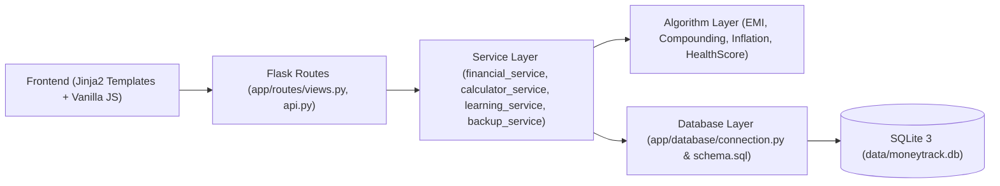
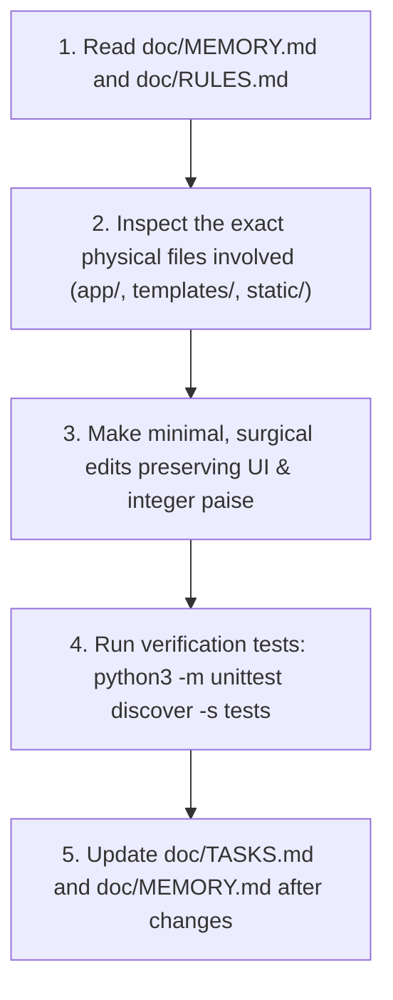

# MoneyTrack — Persistent AI Project Context & Memory

**Document Version:** 1.1.0  
**Status:** Living Engineering Memory & AI Context Anchor  
**Project:** MoneyTrack — Smart Financial Literacy and Budget Planner for Public  
**Core Constraint:** 100% Offline and Privacy-First  
**Target Repository Path:** `doc/MEMORY.md`  
**Current Release Version:** `v0.2.2-beta` (Stable Target: `v1.0.0`)  
**Test Suite Status:** 57/57 Tests Passing (100% Pass Rate via `python3 -m unittest discover -s tests`)  

---

## 1. Project Identity
- **Product Name:** MoneyTrack
- **Full Legal Name:** Smart Financial Literacy and Budget Planner for Public
- **System Classification:** Offline-First Desktop & Local Web Application (SPA / Local Flask Server)
- **Primary Repository:** `/home/prajwal/College Work/PROJECT/Smart Financial Literacy and Budget Planner for Public`
- **Target Audience:** General public, college students, young salaried professionals, and beginners learning personal finance.

---

## 2. Project Purpose
MoneyTrack bridges the gap between passive bookkeeping and active financial education. It provides an air-gapped, privacy-guaranteed personal financial cockpit that helps users log transactions across multiple accounts, establish category budgets, track savings goals, evaluate affordability before purchases, schedule cashflow calendar events, and master core financial concepts (50/30/20 rule, compound interest, loan EMI, emergency funds) without ever transmitting personal data to cloud servers.

---

## 3. Main Objectives
1. **Absolute Offline Sovereignty:** 100% of all features, calculations, and visualizations function without internet access.
2. **Zero-Knowledge Privacy:** Zero cloud databases, zero external telemetry, zero tracking pixels, and zero mandatory external APIs.
3. **Deterministic Mathematical Precision:** All calculations use exact arithmetic in **integer paise** ($1\text{ Rupee} = 100\text{ paise}$) to eliminate floating-point drift.
4. **Behavioral Pedagogy:** Combine daily money tracking with embedded interactive micro-lessons, quizzes, and pre-purchase evaluation ("Can I Afford This?").
5. **Zero-Friction Ergonomics:** Sub-500ms cold boot, sub-16ms UI transitions, and single-click JSON/CSV backup and restore.

---

## 4. Mandatory Offline Requirement
- **Absolute Air-Gap Rule:** The application must start, compute, save, and render completely offline.
- **Local Asset Bundling:** All styles (Tailwind CSS runtime), scripts (Chart.js), fonts, and SVG icons reside locally in `static/vendor/` and `static/css/`.
- **Zero Remote CDN Scripts:** `templates/index.html` loads bundled `/static/vendor/tailwind.min.js` and `/static/vendor/chart.umd.min.js`. Zero external network calls.
- **Offline Python Dependencies:** Pre-packaged dependency wheels and packages reside in `vendor/` and are automatically prepended to `sys.path`.
- **Enforced Content Security Policy (CSP):** `Content-Security-Policy: default-src 'self'; script-src 'self' 'unsafe-inline'; style-src 'self' 'unsafe-inline'; img-src 'self' data:; connect-src 'self'`.

---

## 5. Current Technology Stack
- **Backend Runtime:** Python 3.10+
- **Web Framework:** Flask 3.x (WSGI local server binding to `127.0.0.1:5000` via `run.py`)
- **Database Engine:** SQLite 3 (WAL mode, foreign key enforcement, non-destructive migrations)
- **Template Engine:** Jinja2 (Presentation-only, auto-escaped HTML5)
- **Styling System:** Locally bundled Tailwind CSS (`static/vendor/tailwind.min.js` + `static/css/custom.css`)
- **Client Scripting:** Vanilla JavaScript (ES6+ modular controllers in `static/js/app.js`)
- **Visualization:** Chart.js 4.x (`static/vendor/chart.umd.min.js`) + Dynamic SVG charts
- **Visual Reference Baseline:** `sample_ui/MoneyTrack Financial Planner(DEMO).html` and `doc/references/moneytrack-ui-reference.html`

---

## 6. Existing Project Architecture
MoneyTrack enforces a strict unidirectional layered separation:
$$\textbf{Frontend (Jinja2 + JS)} \longrightarrow \textbf{Flask Routes} \longrightarrow \textbf{Services} \longrightarrow \textbf{Algorithms} \longrightarrow \textbf{Database Layer} \longrightarrow \textbf{SQLite}$$



- **Templates (`templates/`):** Presentation only. `index.html` serves the single-page application; `report.html` renders printer-ready/PDF monthly financial statements.
- **Routes (`app/routes/`):** HTTP transport. `api.py` exposes REST endpoints; `views.py` renders HTML views.
- **Services (`app/services/`):** Business workflow coordination, multi-account ledger math, health scoring, learning progress, backup/export.
- **Database Layer (`app/database/`):** SQLite connection lifecycle, schema initialization, auto-migrations, and catalog seeding.

---

## 7. Directory Structure (Ground Truth)

```
/home/prajwal/College Work/PROJECT/Smart Financial Literacy and Budget Planner for Public/
├── app/
│   ├── database/
│   │   ├── connection.py        # SQLite connection pool with WAL mode, foreign keys, migrations & seeders
│   │   └── schema.sql           # 11-table schema with integer paise currency fields & cascade rules
│   ├── routes/
│   │   ├── api.py               # REST API endpoints (auth, accounts, ledger, budgets, goals, tools)
│   │   └── views.py             # Jinja2 view renderers serving SPA (/) and monthly statement (/report/monthly)
│   ├── services/
│   │   ├── financial_service.py # Double-entry ledger, multi-account type balances, health score algorithm
│   │   ├── calculator_service.py# Precision loan EMI, compound interest, inflation, purchase evaluator
│   │   ├── learning_service.py  # Offline lesson curriculum, multiple-choice quizzes, milestone badges
│   │   ├── backup_service.py    # Atomic JSON snapshot export/import and CSV statement export
│   │   └── validators.py        # Server-side validation (dates, amounts, account types, sanitization)
│   └── __init__.py              # Flask app factory, secret key management, error handlers
├── data/
│   ├── moneytrack.db            # Embedded SQLite local database
│   └── .secret_key              # Persistent 32-byte secret key (0600 permissions)
├── doc/                         # Comprehensive engineering documentation suite
├── issues/                      # Internal project notes (AI excluded)
├── sample_ui/                   # Authoritative visual reference prototypes
│   └── MoneyTrack Financial Planner(DEMO).html
├── static/
│   ├── css/custom.css           # Micro-interactions, custom scrollbars, transitions
│   ├── js/app.js                # Reactive client-side SPA state manager & API client
│   └── vendor/
│       ├── chart.umd.min.js     # Bundled local Chart.js runtime
│       └── tailwind.min.js      # Bundled local Tailwind CSS runtime
├── templates/
│   ├── index.html               # Authoritative single-page application UI matching reference
│   └── report.html              # Printer-ready & PDF exportable monthly statement
├── tests/                       # Automated test suite (57 tests, 100% pass)
│   ├── test_accounts.py
│   ├── test_api.py
│   ├── test_calculators.py
│   ├── test_dashboard_analytics_and_alerts.py
│   ├── test_e2e_workflows.py
│   ├── test_financial_service.py
│   ├── test_security_and_integrity.py
│   └── test_username_auth.py
├── vendor/                      # Bundled offline Python package distribution (Flask, Jinja2, etc.)
├── AGENTS.md                    # AI coding agent instructions
├── README.md                    # Comprehensive user and developer guide
├── requirements.txt             # Standard pip requirements
└── run.py                       # Local application server entry point
```

---

## 8. Database Architecture
- **Database File:** Local SQLite file (`data/moneytrack.db`).
- **Connection PRAGMAs (Mandatory):**
  - `PRAGMA foreign_keys = ON;` (Enforces relational cascades).
  - `PRAGMA journal_mode = WAL;` (Enables concurrent non-blocking reads).
  - `PRAGMA timeout = 10.0;` (Graceful handling of write contention).
- **Relational Tables (11 Active Tables):**
  1. `user_profiles`: ID, name, password_hash, currency, status, is_active, created_at.
  2. `accounts`: ID, profile_id, name, account_type (`savings`, `current`, `cash`, `credit_card`, `wallet`, `investment`), initial_balance_paise, color, icon, is_default.
  3. `categories`: ID, name, type (`income`, `expense`, `both`), color, icon.
  4. `transactions`: ID, profile_id, account_id, destination_account_id, date, description, category_id, type (`income`, `expense`, `transfer`), type_tag (`necessary`, `optional`, `savings`, `debt`), amount_paise.
  5. `budgets`: ID, profile_id, category_id, monthly_limit_paise, month_year.
  6. `savings_goals`: ID, profile_id, name, target_amount_paise, current_amount_paise, target_date, status (`active`, `completed`, `archived`).
  7. `calendar_events`: ID, profile_id, title, amount_paise, type (`income`, `expense`), due_date, frequency (`once`, `weekly`, `monthly`, `yearly`), status (`scheduled`, `paid`, `cancelled`).
  8. `lessons`: ID, slug, title, difficulty, read_time, summary, content, order_index.
  9. `quizzes`: ID, lesson_id, question, options_json, correct_index, explanation.
  10. `user_quiz_results`: ID, profile_id, lesson_id, score, total, completed_at.
  11. `achievements` & `user_achievements`: Milestone catalog and unlocked timestamps.

---

## 9. Important Implementation Decisions
1. **Integer Paise Representation:** All stored and computed currency amounts use integer paise ($₹1.00 = 100\text{ paise}$, `amount_paise INTEGER`). Never use floating-point types for monetary values.
2. **Visual Prototype as Law:** `sample_ui/MoneyTrack Financial Planner(DEMO).html` and `doc/references/moneytrack-ui-reference.html` are authoritative visual references. Never redesign colors, layouts, or component hierarchies without explicit user permission.
3. **Multi-Account Type System:** Supports Assets vs Liabilities (Credit Cards). Asset balance increases with income/transfers and decreases with expenses; Credit Card balance tracks outstanding debt (increases with expenses and decreases with payments/credits). Deleting an account executes `ON DELETE SET NULL`, preserving transactions.
4. **Local Multi-User & Password Security:** Users authenticate locally with password verification via Werkzeug (`generate_password_hash` / `check_password_hash`). Each user's transactions, accounts, budgets, and goals are strictly isolated by `profile_id`.
5. **Zero Cloud/AI Dependencies:** Insights, health score, and calculators are pure, transparent, rule-based algorithms.
6. **Non-Advisory Disclaimer:** Provides educational planning tools, never certified financial or investment advice.

---

## 10. Financial Calculation Conventions
1. **Asset Account Balance:**
   $$\text{Balance} = \text{Initial Balance} + \sum \text{Inflow} - \sum \text{Outflow} + \sum \text{Inbound Transfer} - \sum \text{Outbound Transfer}$$
2. **Liability Account Balance (Credit Card):**
   $$\text{Balance} = \text{Initial Balance} + \sum \text{Outflow (Charges)} - \sum \text{Inflow (Payments)}$$
3. **Loan EMI Amortization:**
   $$r = \frac{\text{Annual Rate}}{12 \times 100}, \quad EMI = \frac{P \cdot r \cdot (1+r)^N}{(1+r)^N - 1}, \quad \text{Total Interest} = (EMI \times N) - P$$
4. **Compound Interest:**
   $$A = P \cdot \left(1 + \frac{r}{100}\right)^t, \quad \text{Yield} = A - P$$
5. **Inflation Future Purchasing Power:**
   $$FV = PV \cdot \left(1 + \frac{i}{100}\right)^t$$
6. **3-Pillar Financial Health Score ($0–100$):**
   $$\text{Score} = \text{Savings Rate (40\%)} + \text{Budget Discipline (35\%)} + \text{Emergency Runway (25\%)}$$
   *(Clamped to 0 for unseeded or empty profiles).*

---

## 11. Current Development Stage & Milestones
- **Current Version:** `v0.2.2-beta` (Dashboard Account-Wise Analytics, Category Budget Limits Manager, Dynamic Insights, Real-Time Alerts, Live System Diagnostics & Background Tab Notifications).
- **Core Architecture:** 100% Implemented (Flask backend, SQLite schema, Jinja2 views, REST APIs).
- **Test Matrix:** 57/57 automated tests passing across 8 test suites.
- **Offline Packaging:** Vendored offline dependencies verified.

---

## 12. Instructions for Future AI Agents



1. **Read Before Editing:** Always read `doc/MEMORY.md`, `doc/RULES.md`, and relevant documentation first.
2. **Inspect Ground Truth:** Always inspect physical files in `app/`, `templates/`, `static/`, and `tests/`. Actual source code is the ultimate authority.
3. **Preserve UI Aesthetics:** Never redesign colors, themes, component shapes, or layouts from the reference UI.
4. **Preserve Air-Gap:** Never introduce external network requests, remote CDNs, or cloud APIs.
5. **Always Enforce Integer Paise:** Use integer minor units (`amount_paise`) for all monetary fields.
6. **Execute Verification Tests:** Run `python3 -m unittest discover -s tests` before declaring any task complete.
