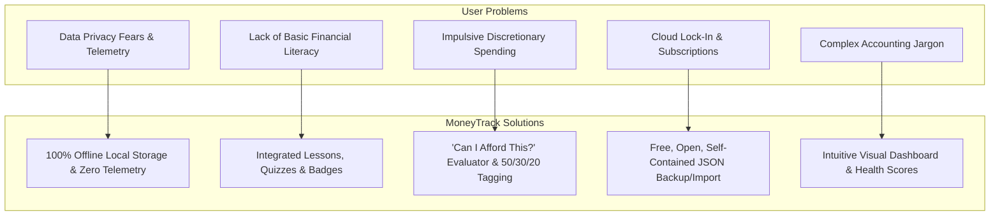
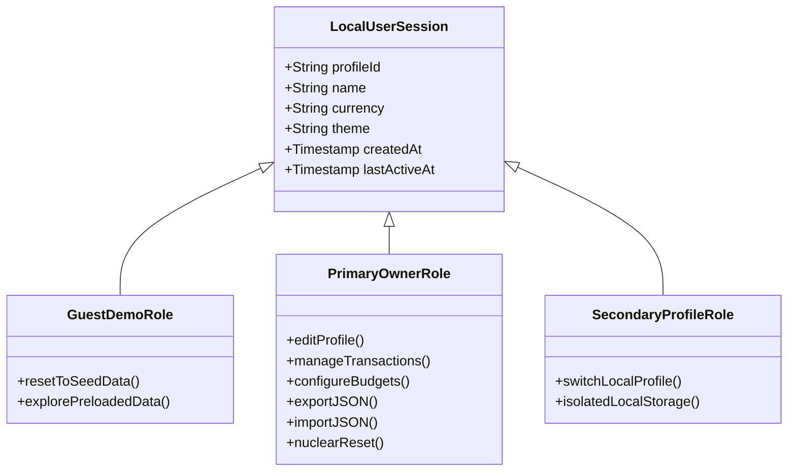
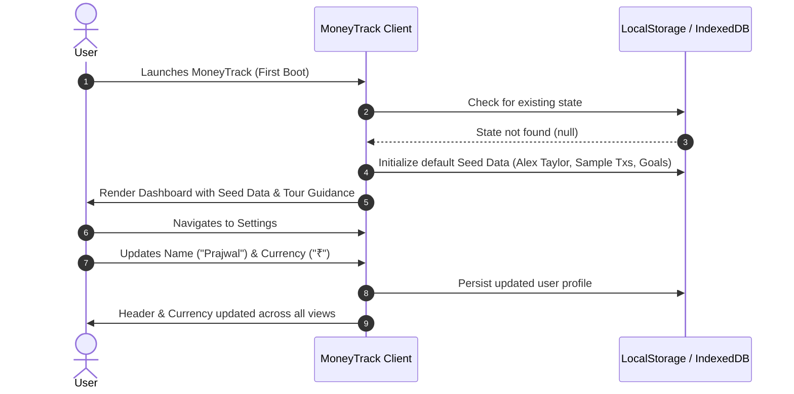
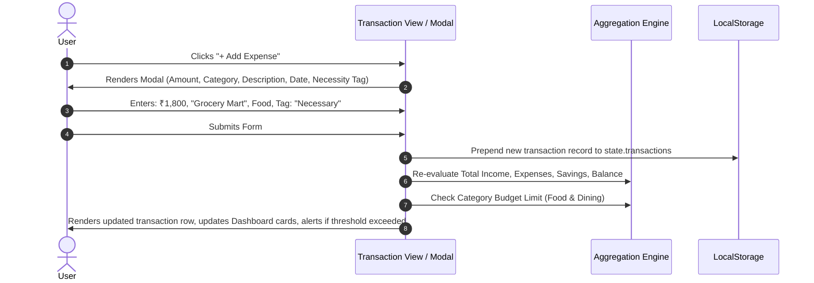
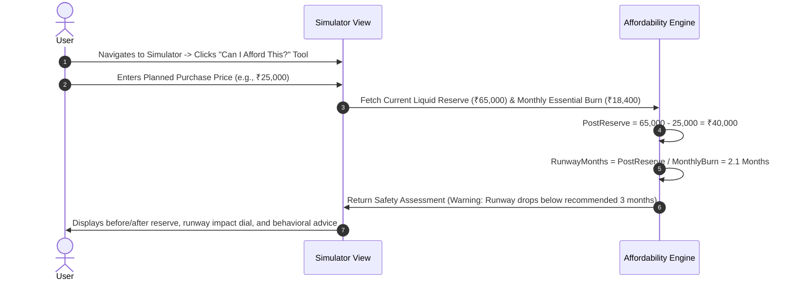
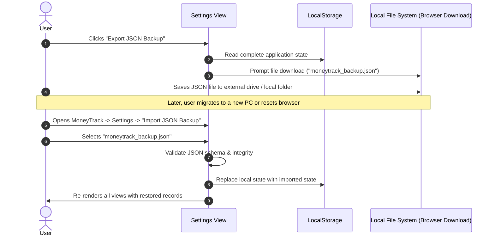
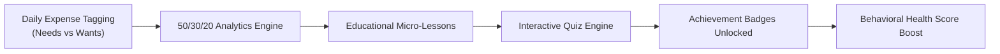
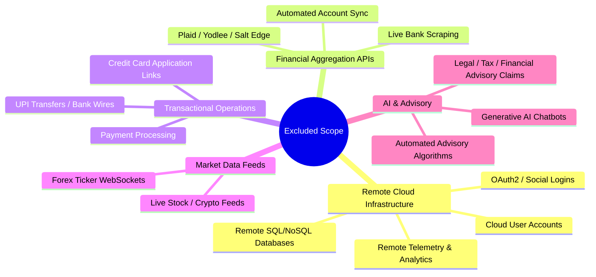

# Product Requirements Document (PRD)

## MoneyTrack — Smart Financial Literacy and Budget Planner

**Document Version:** 1.0.0  
**Status:** Approved / Specification Baseline  
**Classification:** Public & Open Source Architecture  
**Author:** MoneyTrack Engineering & Product Architecture Team  
**Last Updated:** November 2026  
**Target Repository Location:** `doc/PRD.md`  

---

## 1. Product Overview

### 1.1 Product Identification
- **Product Name:** MoneyTrack
- **Full Name:** Smart Financial Literacy and Budget Planner for Public
- **System Classification:** Offline-First Desktop & Local Web Application (Full-Stack Flask SPA)
- **Runtime Environment:** Python 3.10+, Flask 3.x, SQLite 3, Jinja2, Vanilla JavaScript, Bundled Tailwind CSS & Chart.js
- **Authoritative Visual Reference:** `sample_ui/MoneyTrack Financial Planner(DEMO).html` (Archival copy: `doc/references/moneytrack-ui-reference.html`)
- **Architectural Rules Authority:** `doc/AGENTS.md` and `doc/RULES.md`

### 1.2 High-Level Summary
MoneyTrack is an offline-first, privacy-guaranteed personal financial planner and financial literacy platform designed for the general public, with an emphasis on beginners learning personal money management.

Modern personal finance applications commodify user privacy: they demand cloud database accounts, mandate bank login scraping, transmit telemetry to advertising trackers, and monetize user attention via high-interest credit card and loan recommendations. MoneyTrack inverts this paradigm entirely:
- **100% Offline Operation:** Runs without requiring an active internet connection.
- **Zero Cloud Infrastructure:** No remote database, no cloud authentication servers, no external APIs.
- **Absolute Local Data Custody:** All financial ledgers, settings, goals, and profiles reside exclusively on the user's local device.
- **Integrated Behavioral Pedagogy:** Combines practical bookkeeping with financial education—teaching users foundational rules (such as 50/30/20 budgeting), the mechanics of compound interest, debt amortization, and emergency fund protection through interactive simulators, micro-lessons, and quizzes.

### 1.3 Regulatory & Non-Advisory Disclaimer
MoneyTrack provides deterministic mathematical calculations, structured budgeting frameworks, and educational literacy modules. **MoneyTrack does NOT provide certified financial, legal, tax, or investment advice.** The application does not assess user suitability for real-world debt obligations, securities, or financial instruments. All projections, simulations, and health scores are for educational and self-directed planning purposes only.

---

## 2. Problem Statement

### 2.1 The Digital Finance Privacy & Telemetry Crisis
Modern commercial budgeting software requires users to grant third-party aggregators (such as Plaid or Yodlee) continuous read access to personal banking accounts and credit cards. This architecture introduces severe liabilities:
- Financial profiling, credit tracking, and targeted commercial marketing.
- Exposure to remote database leaks and cloud credential breaches.
- Involuntary subscription lock-in (\$5–\$15/month) to access basic ledger functionality and data visualizations.

### 2.2 The Financial Literacy Gap Among Beginners
Millions of individuals—particularly young adults, students, early-career workers, and informal wage earners—navigate personal finance without foundational training:
- **Impulse Spending Disconnect:** Users spend without understanding the consequence on their emergency cash runway.
- **Cognitive Confusion on Interest & Debt:** Beginners often fail to comprehend the exponential cost of compounding loan interest (EMIs) versus the wealth-building effect of compound interest investments.
- **Inflation Ignorance:** Long-term goals are frequently planned with nominal currency figures rather than inflation-adjusted purchasing power.
- **Taxonomy Overwhelm:** Professional double-entry accounting software (e.g., GnuCash, Ledger) is too complex for ordinary users, leading to quick abandonment.

### 2.3 The Connectivity & Fragility Barrier
Cloud-tethered budgeting applications fail or degrade when operated in offline environments, intermittent network areas, or air-gapped environments where users prioritize security isolation.

---

## 3. Product Vision

To establish the world standard for **sovereign personal financial tooling**—delivering a private, transparent, resilient, and pedagogically rich financial cockpit that empowers any individual to conquer financial insecurity, cultivate disciplined savings habits, and master financial principles without surrendering a single byte of personal data to the cloud.

---

## 4. Product Goals

| Goal ID | Objective | Measurable Key Result |
| :--- | :--- | :--- |
| **G-01** | **Absolute Offline Sovereignty** | 100% of application features function without an active internet connection. Exactly zero HTTP/WebSocket requests made to external servers during core workflows. |
| **G-02** | **Zero Data Leakage** | All user records, financial logs, goals, and profiles persist strictly in local browser storage (`localStorage` / `IndexedDB`). Zero telemetry, zero analytics tracking. |
| **G-03** | **Mathematical Precision** | All calculators (EMI, Compound Interest, Inflation) and aggregators execute deterministic arithmetic with verified unit test suites matching standard banking formulae. |
| **G-04** | **Actionable Behavioral Guidance** | Shift users from reactive logging to proactive decision-making via interactive tools like the *"Can I Afford This?"* purchase evaluator and What-If scenario simulator. |
| **G-05** | **Integrated Financial Literacy** | Combine expense tracking with self-paced micro-lessons, interactive quizzes, and unlockable achievements, improving beginner literacy score benchmarks. |
| **G-06** | **Zero Friction & High Accessibility** | Near-zero cold boot load time (< 500ms), sub-16ms UI updates, full dark/light aesthetic matching the authoritative prototype, and seamless single-click JSON backup/restore. |

---

## 5. Target Audience

### 5.1 Primary Persona: The Financial Novice ("The Beginner")
- **Profile:** College students, fresh graduates, first-time salaried employees, and young adults managing an independent budget for the first time.
- **Pain Points:** Overwhelmed by financial terminology; prone to impulsive end-of-month deficits; lacks an emergency fund; has never calculated loan amortization or inflation.
- **Key Need:** Clear, visual, non-judgmental guidance; simple "Needs vs Wants" categorization; instant feedback on whether a discretionary purchase is safe.

### 5.2 Secondary Persona: The Privacy-Conscious Budgeter ("The Sovereign Planner")
- **Profile:** Software developers, privacy advocates, security professionals, and users who refuse to share banking credentials with cloud fintech startups.
- **Pain Points:** Frustrated by applications demanding phone numbers, cloud logins, and bank scraping permissions; unwilling to tolerate third-party data profiling.
- **Key Need:** Complete air-gapped operation; transparent local data storage (inspectable JSON/SQLite); deterministic offline backup and restore.

### 5.3 Tertiary Persona: The Low-Connectivity / Cash-Dominant User ("The Practical Saver")
- **Profile:** Users residing in regions with unstable internet access, gig workers, small informal business owners, or cash-based household managers.
- **Pain Points:** Cloud-based apps fail to load or sync errors when connectivity drops; apps assume all transactions originate from linked credit cards.
- **Key Need:** Instant manual transaction entry; custom offline calendar for cash flow obligations; zero requirement for remote synchronization.

---

## 6. User Problems and Needs

---

## 7. Core Product Principles

1. **Offline by Default, Offline by Design:** No feature shall ever require an internet connection or remote microservice to function. If a feature cannot operate offline, it does not belong in MoneyTrack.
2. **Zero-Knowledge Data Custody:** The user is the sole owner and custodian of their financial database. No remote server, developer telemetry endpoint, or third-party SDK shall ever receive user records.
3. **Pedagogy Embedded in Workflow:** Financial education is not a detached side menu; it is woven into transactions, budget alerts, and scenario simulations.
4. **Deterministic Accuracy:** Calculations must use exact financial mathematics. Rounding conventions must be consistent and transparent.
5. **No AI/ML Hallucinations:** Recommendations and insights must be strictly rule-based, deterministic, and verifiable. Do not introduce black-box machine learning models or remote generative AI calls.
6. **Design Fidelity:** The user interface must preserve the layout, styling, typography, colors, and responsive structures defined in the authoritative visual reference (`sample_ui/MoneyTrack Financial Planner.html`).

---

## 8. Functional Requirements

### 8.1 System Navigation & Layout (Global)
- **FR-NAV-01:** The system shall provide a responsive sidebar navigation for desktop screens (width $\ge 768\text{px}$) and a responsive mobile top/bottom navigation bar for smaller viewports.
- **FR-NAV-02:** Navigation items shall switch active view panels dynamically without browser page reloads:
  1. `dashboard` (Financial Overview & Quick Health Check)
  2. `money` (Transactions, Filtering, Categorization)
  3. `goals` (Savings Goals & Deposit Tracking)
  4. `simulator` (What-If Scenarios & "Can I Afford This?")
  5. `calendar` (Future Cash Flow & Bill Timeline)
  6. `analytics` (Trends, 50/30/20 Ratios, MoM Deltas)
  7. `learn` (Educational Lessons, Quizzes, Badges)
  8. `tools` (EMI, Compound Interest, Inflation Calculators)
  9. `settings` (Profile, Currency, Theme, Backup/Restore)
- **FR-NAV-03:** Active view state shall update DOM classes to reflect the currently selected navigation button.

### 8.2 State Persistence Engine
- **FR-ST-01:** The application shall maintain state in memory during runtime and persist all state mutations immediately to client-side storage.
- **FR-ST-02:** When the application initializes, it shall inspect local storage for existing state. If no state is detected, it shall load pre-configured seed data to enable immediate exploration.
- **FR-ST-03:** The state schema shall encapsulate: `user`, `theme`, `transactions`, `budgets`, `goals`, `calendarEvents`, `achievements`, and `quizState`.

### 8.3 Theme & Appearance Engine
- **FR-TH-01:** The application shall support both Dark and Light themes.
- **FR-TH-02:** The HTML root document shall toggle the `.dark` class upon theme change.
- **FR-TH-03:** The active theme preference shall be stored in local storage and applied immediately on application boot before DOM painting to eliminate visual flash.

### 8.4 Currency Engine
- **FR-CU-01:** The application shall support customizable local currency formatting.
- **FR-CU-02:** Supported currencies in initial release:
  - Indian Rupee (`₹`, INR) — Default
  - US Dollar (`$`, USD)
  - Euro (`€`, EUR)
  - British Pound (`£`, GBP)
  - Japanese Yen (`¥`, JPY)
- **FR-CU-03:** Currency symbols shall dynamically update across all headers, cards, tables, modal forms, and calculation outputs upon user selection.

---

## 9. Non-Functional Requirements

### 9.1 Performance & Latency
- **NFR-PERF-01 (Load Time):** Cold boot load time from local filesystem or local HTTP server shall be $< 500\text{ms}$ on standard hardware.
- **NFR-PERF-02 (UI Interaction):** View switches, modal openings, and tab switching shall execute in $< 16\text{ms}$ (60 FPS rendering target).
- **NFR-PERF-03 (Search & Filter):** Filtering 5,000 local transactions by string search, category, or type tag shall complete in $< 50\text{ms}$.
- **NFR-PERF-04 (Storage Footprint):** Initial application bundle (HTML/CSS/JS) shall remain under $2\text{MB}$ uncompressed.

### 9.2 Reliability & Data Integrity
- **NFR-REL-01 (Atomic Backup):** JSON export operations shall generate a validated, schema-compliant JSON payload containing the exact timestamped state.
- **NFR-REL-02 (Import Validation):** The import parser shall validate required schema fields (`user`, `transactions`, `goals`) before overwriting application state. Corrupted files must be rejected with user-visible error dialogs.
- **NFR-REL-03 (Calculation Determinism):** Financial formulas shall produce identical results across all modern browser engines (V8, JavaScriptCore, Gecko).

### 9.3 Security & Privacy
- **NFR-SEC-01 (Network Air-Gap):** The application shall execute zero outgoing `fetch`, `XMLHttpRequest`, or `WebSocket` requests to remote servers during operation.
- **NFR-SEC-02 (Content Security Policy):** The production build shall enforce a strict Content Security Policy (`connect-src 'none'`).
- **NFR-SEC-03 (Zero Third-Party Trackers):** No third-party analytics (Google Analytics, Mixpanel, Sentry, Facebook Pixel) or CDN tracking pixels shall be present in the codebase.
- **NFR-SEC-04 (Local Sandbox Isolation):** Data stored in browser storage shall remain accessible only to the originating domain/local file protocol context.

### 9.4 Usability & Accessibility
- **NFR-ACC-01 (Contrast):** Text color ratios shall comply with WCAG 2.1 AA standards ($\ge 4.5:1$ for normal body text) in both Dark and Light themes.
- **NFR-ACC-02 (Semantic Elements):** All interactive controls shall use native HTML semantic tags (`<button>`, `<input>`, `<select>`, `<dialog>`/modal) with keyboard focus rings.
- **NFR-ACC-03 (Responsive Layout):** The application shall render without horizontal scrolling or element breakage on screen widths from $360\text{px}$ to $2560\text{px}$.

---

## 10. User Roles and Local Profiles

Because MoneyTrack operates with strict offline privacy, user roles and identity management are entirely client-side. There are no remote role-based access control (RBAC) servers or cloud authorization tokens.

### 10.1 Role & Profile System (Implemented in v0.1.8-beta+)
1. **Default Seed Profile:**
   - Automatically provisions initial user (`Alex Taylor`) with default accounts, transactions, and categories for immediate exploratory usage.
2. **Multi-User Profile & Username Authentication:**
   - Supports multiple user profiles in `user_profiles` table.
   - Users authenticate locally via username and password hashed with Werkzeug (`scrypt`/`pbkdf2:sha256`).
   - Profile endpoints (`/api/auth/register`, `/api/auth/login`, `/api/auth/logout`, `/api/auth/change-password`, `/api/auth/users`).
   - Complete multi-tenant data isolation: all financial ledgers, accounts, budgets, goals, and calendar events are scoped strictly by `profile_id`.
3. **Local Administration & Backup:**
   - Profile owners can configure accounts across 6 types, export/import JSON and CSV statements, and execute local database resets.

---

## 11. User Workflows

### 11.1 Workflow 1: First-Time Onboarding & Customization

### 11.2 Workflow 2: Transaction Logging with Behavioral Tagging

### 11.3 Workflow 3: Pre-Purchase Evaluation ("Can I Afford This?")

### 11.4 Workflow 4: Offline Backup and Recovery

---

## 12. Financial Management Requirements

### 12.1 Multi-Account & Transaction Engine
- **FMR-ACC-01 (Multi-Account Support):** Support 6 distinct financial account types:
  - 🏦 `savings` (Savings Account - Asset)
  - 🏢 `current` (Current / Checking Account - Asset)
  - 💵 `cash` (Physical Cash / Wallet - Asset)
  - 💳 `credit_card` (Credit Card - Liability)
  - 📱 `wallet` (Digital Wallet / UPI - Asset)
  - 📈 `investment` (Investment / Demat / FD - Asset)
- **FMR-ACC-02 (Balance Calculation Logic):**
  - Asset Accounts: $\text{Balance} = \text{Initial Balance} + \text{Inflow} - \text{Outflow} + \text{Transfers In} - \text{Transfers Out}$
  - Liability Accounts (Credit Cards): $\text{Current Balance} = \text{Initial Balance} + \text{Outflow (Charges)} - \text{Inflow (Payments/Credits)}$
  - Safe cascade deletion with `ON DELETE SET NULL`.
- **FMR-TX-01 (Integer Paise Transaction Fields):** Every transaction record contains:
  - `id`: Auto-incrementing integer identifier.
  - `profile_id`: Scoped user profile ID.
  - `account_id` & `destination_account_id`: Linked accounts (nullable).
  - `type`: Categorical enumeration (`income`, `expense`, `transfer`).
  - `amount_paise`: Positive integer minor units ($1\text{ INR} = 100\text{ paise}$).
  - `category_id`: Foreign key reference to `categories` table.
  - `description`: String memo describing the entry.
  - `date`: ISO 8601 date string (`YYYY-MM-DD`).
  - `type_tag`: Behavioral classification (`necessary`, `optional`, `savings`, `debt`).
- **FMR-TX-02 (Filtering & Sorting):**
  - Instant filter tabs: `All Transactions`, `Income`, `Expenses`, `Subscriptions`.
  - Account and payment method filter pills.
  - Category dropdown filter matching specific categories.
  - Search input: real-time substring matching against `description`.
  - Chronological sort: newest transactions displayed first by default.
- **FMR-TX-03 (CRUD Operations):**
  - Create transaction via modal dialog with account assignment.
  - Edit and delete transaction with instant balance recalculation and UI re-render.

### 12.2 Category Budgeting & Threshold Alerts
- **FMR-BG-01:** Users shall establish maximum monthly spending limits per category.
- **FMR-BG-02:** The system shall calculate spent percentage: $\text{pct} = \left(\frac{\text{spent}}{\text{limit}}\right) \times 100$.
- **FMR-BG-03:** Automated visual indicators:
  - $\text{pct} < 90\%$: Normal status (Brand green progress bar).
  - $90\% \le \text{pct} \le 100\%$: Warning threshold (Amber progress bar).
  - $\text{pct} > 100\%$: Budget exceeded (Rose/Red progress bar, dashboard alert card dispatched).

### 12.3 Savings Goals Engine
- **FMR-GL-01 (Goal Structure):**
  - `id`: Unique goal ID.
  - `name`: Target title (e.g., "Emergency Safety Reserve", "New Laptop").
  - `targetAmount`: Target monetary amount.
  - `currentAmount`: Accumulated monetary deposit.
  - `date`: Target completion deadline (`YYYY-MM-DD`).
- **FMR-GL-02 (Progress Calculation):**
  - Progress percentage: $\min\left(100, \left\lfloor\frac{\text{currentAmount}}{\text{targetAmount}} \times 100\right\rfloor\right)\%$.
  - Remaining deficit: $\max(0, \text{targetAmount} - \text{currentAmount})$.
- **FMR-GL-03 (Deposit Interactions):**
  - One-click increment deposit button (+₹1,000 default or custom deposit modal in V1.0).
  - Instant progress bar animation update.
  - Goal completion badge check upon reaching 100%.

### 12.4 Future Money Calendar & Cash Flow Commitments
- **FMR-CAL-01:** Track scheduled, upcoming recurring transactions (e.g., monthly rent, salary credit date, internet bills, loan EMIs).
- **FMR-CAL-02:** Display chronological timeline of commitments for the active calendar month.
- **FMR-CAL-03:** Month-End Projected Cash Flow Forecast:
  $$\text{Projected End Balance} = \text{Current Balance} + \sum \text{Upcoming Incomes} - \sum \text{Upcoming Outflows}$$

---

## 13. Financial Literacy Requirements

Financial literacy is a first-class citizen inside MoneyTrack, integrated directly alongside functional money management.

### 13.1 Educational Micro-Lessons (Curriculum)
The application includes pre-bundled, offline-accessible interactive lessons:
1. **Lesson 1: The 50/30/20 Budgeting Rule**
   - *Core Concept:* 50% for Needs (rent, basic groceries, utilities), 30% for Wants (dining out, entertainment, hobbies), 20% for Savings and debt reduction.
   - *Behavioral Guidance:* How to classify borderline expenses and reallocate discretionary spending without lifestyle deprivation.
2. **Lesson 2: The Power of Compound Interest**
   - *Core Concept:* How interest earns interest over time. The mathematical advantage of starting early ($A = P(1+r)^t$).
   - *Behavioral Guidance:* Why compound interest works against borrowers in high-interest consumer debt, and works for disciplined savers.
3. **Lesson 3: Emergency Funds & Safety Nets**
   - *Core Concept:* The 3-to-6 month living expense runway rule. Keeping funds in high-liquidity, low-risk accounts.
   - *Behavioral Guidance:* Identifying genuine emergencies versus predictable seasonal expenses.

### 13.2 Interactive Quiz Engine
- **FLR-QZ-01:** Multi-question structured assessment for each curriculum topic.
- **FLR-QZ-02:** Instant pedagogical feedback upon selecting an option:
  - If correct: Green affirmative banner explaining *why* the answer is sound.
  - If incorrect: Amber/Red constructive banner identifying the fallacy and explaining the correct mathematical/financial logic.
- **FLR-QZ-03:** Score tracker recording running accuracy.
- **FLR-QZ-04:** Topic completion status persisted to local state.

### 13.3 Gamification & Achievement Badges
- **FLR-ACH-01:** Deterministic badge unlocking based on real application events:
  - `First Entry Recorded`: Awarded upon saving the first transaction.
  - `Goal Setter`: Awarded upon creating the first personal savings goal.
  - `Quiz Scholar`: Awarded upon achieving 100% on any literacy quiz.
  - `Budget Master`: Awarded when optional discretionary spending remains $\le 30\%$ of total monthly expenditure.
  - `Emergency Guard` (V1.0): Awarded when emergency reserve covers $\ge 3$ months of essential living expenses.

---

## 14. Analytics and Insights Requirements

### 14.1 Financial Health Score Engine
The application calculates a holistic Financial Health Score ($0–100$) evaluated across four pillars:

$$\text{Health Score} = S_{\text{savings}} \times 0.35 + S_{\text{budget}} \times 0.25 + S_{\text{runway}} \times 0.25 + S_{\text{ratio}} \times 0.15$$

| Pillar | Metric Evaluated | Formula / Target | Weight |
| :--- | :--- | :--- | :--- |
| **Savings Rate** ($S_{\text{savings}}$) | Proportion of income saved | $\text{Rate} = \frac{\text{Income} - \text{Expenses}}{\text{Income}}$. Score 100 if $\ge 20\%$. | 35% |
| **Budget Discipline** ($S_{\text{budget}}$) | Categories within limits | $\frac{\text{Categories within limit}}{\text{Total budgeted categories}} \times 100$ | 25% |
| **Emergency Runway** ($S_{\text{runway}}$) | Liquid reserves vs burn | $\text{Months} = \frac{\text{Liquid Savings}}{\text{Monthly Essential Expenses}}$. Score 100 if $\ge 3$ months. | 25% |
| **Needs vs Wants** ($S_{\text{ratio}}$) | Discretionary discipline | Score 100 if Wants $\le 30\%$ of total income. Scaled down linearly if $> 30\%$. | 15% |

- **AIR-HS-01:** Visual representation via SVG donut/ring chart with score tier labels:
  - $80–100$: Excellent / Strong Financial Stability (Green)
  - $65–79$: Good / Resilient with Optimization Opportunities (Blue/Teal)
  - $50–64$: Fair / Warning signs present (Amber)
  - $< 50$: Needs Attention / High Vulnerability (Rose/Red)

### 14.2 Spending Distribution & Category Breakdown
- **AIR-SP-01:** Aggregate expenditure grouped by category for the current month.
- **AIR-SP-02:** SVG Donut chart displaying proportional breakdown with color-coded legend and currency sums.

### 14.3 Needs vs. Optional Spending (50/30/20 Ratio)
- **AIR-5030-01:** Aggregate transactions by `typeTag`:
  - `Necessary` $\rightarrow$ Needs
  - `Optional` $\rightarrow$ Wants
  - Net Income minus Expenses $\rightarrow$ Savings
- **AIR-5030-02:** Display target percentage vs actual percentage with status badges:
  - Needs: Target 50% (Current vs Target variance badge)
  - Wants: Target 30% (Current vs Target variance badge)
  - Savings: Target 20% (Current vs Target variance badge)

### 14.4 "What Changed?" — Month-over-Month (MoM) Delta
- **AIR-MOM-01:** Compare current month performance against previous month across:
  - Income delta ($\%\Delta$ and absolute delta)
  - Expense delta ($\%\Delta$ and absolute delta)
  - Net savings delta ($\%\Delta$ and absolute delta)
  - Category with the single largest cost increase (e.g., "Top Increase: Dining Out +₹1,200")

---

## 15. Offline Functionality Requirements

### 15.1 Zero-Network Guarantee
- **OFR-01:** Every script, stylesheet, SVG graphic, font, and calculation logic file must be bundled locally or served from local cache.
- **OFR-02:** The application shall not issue requests to any Content Delivery Network (CDN) at runtime in production builds. Tailwind CSS / styles must be pre-compiled into local CSS.
- **OFR-03:** Disconnecting the physical machine from Ethernet and Wi-Fi must produce zero application degradation, zero console error logs, and zero blank views.

### 15.2 Client-Side Calculation Engines
- **OFR-04 (EMI Calculator):**
  $$r = \frac{\text{Annual Interest Rate}}{12 \times 100}, \quad N = \text{Tenure in Months}$$
  $$\text{Monthly EMI} = \begin{cases} \frac{P \cdot r \cdot (1 + r)^N}{(1 + r)^N - 1} & \text{if } r > 0 \\ \frac{P}{N} & \text{if } r = 0 \end{cases}$$
  $$\text{Total Interest} = (\text{Monthly EMI} \times N) - P$$
- **OFR-05 (Compound Interest Calculator):**
  $$A = P \cdot \left(1 + \frac{r}{100}\right)^t, \quad \text{Total Interest Earned} = A - P$$
- **OFR-06 (Inflation Impact Calculator):**
  $$\text{Future Cost } FV = PV \cdot \left(1 + \frac{i}{100}\right)^t$$
  Where $PV$ is current cost, $i$ is annual inflation rate percentage, and $t$ is years into future.

### 15.3 Storage Longevity & Recovery
- **OFR-07:** Data stored in `localStorage` or `IndexedDB` must persist across browser tab closures, browser restarts, and operating system reboots.
- **OFR-08:** Users can download their complete state as an offline `.json` file at any time.

---

## 16. Privacy Requirements

### 16.1 Local Custody Architecture
- **PRV-01 (Zero Remote Transmission):** Financial figures, transaction descriptions, payee names, and balance totals must never cross the boundary of the local device.
- **PRV-02 (No Authentication Server):** No email verification, phone OTP, OAuth2, or cloud password systems. The user is logged in automatically to their local sandbox.
- **PRV-03 (Zero Third-Party Code Execution):** No remote scripts from Google, Meta, Mixpanel, or advertising networks.

### 16.2 Nuclear Reset & Sanitization
- **PRV-04:** The Settings view must provide a prominent "Reset All Local Application Data" button.
- **PRV-05:** Upon confirmation, the application shall completely wipe all keys in local storage, purge runtime memory, and cleanly reset state to a blank or default seed slate.

---

## 17. MVP Scope

The Minimum Viable Product (MVP) solidifies the functional core demonstrated in the prototype (`sample_ui/MoneyTrack Financial Planner.html`), eliminating hardcoded stubs in the core ledger and simulators while ensuring 100% offline persistence.

### 17.1 Existing Prototype Audit & MVP Status

| Feature Module | Current Prototype Status | Action for MVP Completion |
| :--- | :--- | :--- |
| **Theme Engine** | Fully implemented in prototype (`dark`/`light`) | Retain and preserve styling |
| **User Profile & Currency** | Fully implemented in prototype (Name & Currency select) | Retain and preserve styling |
| **Transaction CRUD** | Add & Delete working; Filter by tab/category working | Retain and verify schema durability |
| **Savings Goals** | Create, Delete, +1,000 quick deposit working | Retain and preserve styling |
| **Calculators (EMI, CI, Inflation)** | Deterministic mathematical calculation working | Retain; add input validation |
| **JSON Export / Import** | Single-click export & import working | Enhance schema error boundary |
| **What-If Scenario Simulator** | Working with hardcoded baseline (6,600) | Wire directly to user's real dynamic net savings |
| **"Can I Afford This?" Evaluator** | Working with hardcoded reserves (65,000) | Wire directly to user's real balance & expense burn |

### 17.2 Detailed MVP Feature Specifications

#### Feature MVP-01: Core Transaction Ledger & Balance Engine
- **Purpose:** Provide an offline ledger for tracking all income and expense items with automatic net balance calculation.
- **Expected Behaviour:**
  - Clicking "+ Add Income" or "+ Add Expense" opens a responsive modal dialog.
  - Form collects Amount, Category, Description, Date, and Need/Want tag (`typeTag`: `necessary` | `optional`).
  - Upon submission, record prepends to state array, balance metrics update immediately, and table refreshes.
  - Filter tabs ("All Transactions", "Income", "Expenses") and category dropdown isolate matching records instantly.
  - Search input filters records matching description or category with zero lag.
  - Clicking the delete icon removes the record and recalculates all totals.
- **Acceptance Criteria:**
  - Balance strictly equals $\sum \text{Income} - \sum \text{Expenses}$.
  - Storage survives browser reload with zero data loss.
  - Table empty-state displays gracefully when no records match filter criteria.

#### Feature MVP-02: Client-Side Financial Calculators (EMI, Compound Interest, Inflation)
- **Purpose:** Demystify financial mathematics for beginners through instant client-side calculation engines.
- **Expected Behaviour:**
  - *EMI Calculator:* Inputs loan principal ($P$), annual interest rate ($r$), tenure in months ($N$). Reactive output displays monthly payment and total interest payable.
  - *Compound Interest Calculator:* Inputs principal ($P$), annual interest rate ($r$), tenure in years ($t$). Reactive output displays total maturity value and compound interest earned.
  - *Inflation Calculator:* Inputs current cost ($PV$), annual inflation rate ($i$), years ($t$). Reactive output displays future equivalent cost.
- **Acceptance Criteria:**
  - All outputs match standardized banking formulas within $\pm 1$ currency unit rounding.
  - Changing any input input triggers reactive DOM updates within $< 10\text{ms}$.
  - Zero/negative inputs fail gracefully without yielding `NaN` or runtime exceptions.

#### Feature MVP-03: Dynamic What-If Scenario & Purchase Simulator
- **Purpose:** Help users evaluate the future consequences of lifestyle spending and large purchases before committing cash.
- **Expected Behaviour:**
  - *What-If Tab:* Adjusting the monthly delta slider simulates monthly savings and projected 12-month wealth accumulation. Baseline is dynamically sourced from the user's real average savings rate.
  - *"Can I Afford This?" Tab:* User enters a target purchase price. The tool computes post-purchase liquid reserve and remaining runway in months based on the user's real monthly essential burn rate.
- **Acceptance Criteria:**
  - Dynamic integration: Does not rely on hardcoded static numbers.
  - Safety status visually indicates if post-purchase runway falls below the recommended 3-month threshold.

#### Feature MVP-04: Savings Goal Tracker
- **Purpose:** Enable goal-oriented saving habits with visual progress milestones.
- **Expected Behaviour:**
  - User creates goal with Title, Target Amount, Initial Deposit, and Deadline.
  - Card displays target amount, current deposit, remaining deficit, deadline, and percentage progress bar.
  - Quick "Deposit" button increments deposit by default step (+₹1,000) and updates the progress bar animation.
  - User can delete completed or cancelled goals.
- **Acceptance Criteria:**
  - Progress bar dynamically clamps at $100\%$.
  - Remaining deficit displays $\max(0, \text{Target} - \text{Current})$.

#### Feature MVP-05: Offline JSON Backup & Recovery
- **Purpose:** Ensure user data sovereignty through effortless local file export and restoration.
- **Expected Behaviour:**
  - "Export JSON Backup" triggers a direct browser download of `moneytrack_backup.json` containing timestamped state.
  - "Import JSON Backup" accepts a local JSON file, verifies presence of required fields (`user`, `transactions`, `goals`), updates state, and renders all views.
- **Acceptance Criteria:**
  - Exported JSON file is valid UTF-8.
  - Corrupt or invalid JSON files fail gracefully with an alert banner without destroying active state.

#### Feature MVP-06: Profile & Currency Customization
- **Purpose:** Personalize the user experience to match local regional context.
- **Expected Behaviour:**
  - User updates their display name and selects currency symbol (`₹`, `$`, `€`, `£`, `¥`).
  - Header and all currency labels across all 9 views update dynamically upon saving.
- **Acceptance Criteria:**
  - Profile state persists across sessions in local storage.

#### Feature MVP-07: Dark / Light Theme Engine
- **Purpose:** Provide optimal visual ergonomics in both low-light and bright environments.
- **Expected Behaviour:**
  - Clicking the theme toggle switches between Dark and Light mode.
  - Applies or removes `.dark` class on root `<html>` element without page flicker.
- **Acceptance Criteria:**
  - Theme preference persists in local storage and is restored prior to initial paint.

---

## 18. Version 1.0 Scope

Version 1.0 elevates MoneyTrack from an MVP tracker into a comprehensive financial intelligence and literacy platform. It converts mock visual components from the prototype into dynamic, data-driven engines.

### 18.1 Detailed Version 1.0 Feature Specifications

#### Feature V1-01: Dynamic Financial Health Score Engine
- **Purpose:** Provide users with an objective, single-number health metric evaluating overall financial stability.
- **Expected Behaviour:**
  - The system dynamically aggregates transactions, budgets, goals, and reserves to compute the four-pillar Health Score ($0–100$) according to the formula in Section 14.1.
  - The dashboard SVG ring chart renders score, tier badge ("Excellent", "Good", "Fair", "Needs Attention"), and sub-pillar ratings dynamically.
  - Contextual advice cards highlight the specific pillar dragging the score down.
- **Acceptance Criteria:**
  - Calculated score updates automatically when transactions or goals change.
  - Empty or newly initialized accounts display a neutral welcome baseline prompting initial entries.

#### Feature V1-02: Category Budget Limits & Real-Time Alert Dispatcher
- **Purpose:** Prevent discretionary overspending through configurable monthly category limits and automated warning alerts.
- **Expected Behaviour:**
  - "Manage Budgets" modal allows users to set monthly spending ceilings for each category.
  - Dashboard renders progress bars for budgeted categories comparing actual month-to-date spending against limits.
  - Automated visual states: Normal ($< 90\%$), Warning ($90\%–100\%$), Exceeded ($> 100\%$).
  - Over-budget categories automatically dispatch warning cards to the "Financial Alerts & Warnings" panel.
- **Acceptance Criteria:**
  - Actual spending aggregates exclusively from expenses logged within the current calendar month.
  - Threshold alerts update immediately upon logging an expense.

#### Feature V1-03: Interactive Financial Literacy Quiz Engine
- **Purpose:** Educate users on budgeting, compounding, and safety reserves through active pedagogical recall.
- **Expected Behaviour:**
  - Clicking "Start Quiz & Lesson" on any curriculum card activates the interactive quiz container.
  - Displays questions with multiple-choice choices.
  - Selecting an answer renders immediate constructive feedback:
    - Correct: Green banner reinforcing the financial logic.
    - Incorrect: Clarifying banner debunking common financial misconceptions.
  - "Next Question" advances the assessment; final question displays topic mastery score.
- **Acceptance Criteria:**
  - Complete implementation of `startQuiz(index)` and `nextQuestion()` logic in application script.
  - Scoring 100% on a quiz triggers unlocking of the `Quiz Scholar` achievement badge.

#### Feature V1-04: Dynamic 50/30/20 Spending Ratio & MoM Trend Analytics
- **Purpose:** Provide automated behavioral analysis dividing expenses into Needs, Wants, and Savings, alongside month-over-month variance tracking.
- **Expected Behaviour:**
  - Aggregates expenses by `necessary` (Needs) vs `optional` (Wants) tags and compares against net savings.
  - Visual cards in the Analytics view display target vs actual percentages with optimization badges.
  - "What Changed?" panel computes percentage and absolute deltas for Income, Expenses, and Savings compared to the prior calendar month.
  - Automatically identifies the category with the highest spending growth.
- **Acceptance Criteria:**
  - Ratios calculate accurately: $\text{Needs}\% + \text{Wants}\% + \text{Savings}\% = 100\%$ of income.
  - Month-over-month logic handles boundary conditions (e.g., first month of usage with no prior history).

#### Feature V1-05: Interactive Future Cash Flow Calendar
- **Purpose:** Give users foresight into upcoming bills and recurring obligations to avoid cash shortfalls.
- **Expected Behaviour:**
  - "Add Planned Cashflow" button launches a modal to record upcoming bills, salary credits, or loan EMIs with scheduled dates.
  - Calendar timeline lists events chronologically with color-coded badges (Green for income, Red for expenses).
  - "Month-End Forecast" card calculates projected closing cash balance: $\text{Current Balance} + \sum \text{Upcoming Income} - \sum \text{Upcoming Outflows}$.
- **Acceptance Criteria:**
  - Planned events persist in local storage.
  - Users can mark scheduled events as paid/received, which automatically logs them as actual transactions.

#### Feature V1-06: Event-Driven Achievements & Badges Engine
- **Purpose:** Gamify positive financial behavior and habit formation.
- **Expected Behaviour:**
  - System evaluates achievement milestones upon state mutations:
    - `First Entry Recorded`: Triggered upon saving first transaction.
    - `Goal Setter`: Triggered upon creating first savings goal.
    - `Quiz Scholar`: Triggered upon achieving 100% on any literacy quiz.
    - `Budget Master`: Triggered when optional spending remains $\le 30\%$ for the month.
  - Unlocked badges display in full opacity with achievement date; locked badges remain semi-transparent.
- **Acceptance Criteria:**
  - Unlocked status persists permanently in state.

#### Feature V1-07: IndexedDB Structured Local Database Engine
- **Purpose:** Upgrade from `localStorage` stringified JSON to IndexedDB for enhanced storage capacity, reliability, and transaction querying.
- **Expected Behaviour:**
  - All state collections (`transactions`, `goals`, `budgets`, `calendar`) reside in structured IndexedDB object stores.
  - Seamless migration from legacy `localStorage` on initial boot.
- **Acceptance Criteria:**
  - Transparent backward compatibility: existing `localStorage` data auto-migrates without data loss.

#### Feature V1-08: CSV / Tabular Statement Export & Import
- **Purpose:** Enable data portability with standard spreadsheet software (Excel, LibreOffice Calc).
- **Expected Behaviour:**
  - User can export transaction ledger as a comma-separated `.csv` file.
  - User can import standard CSV files with column mapping (Date, Description, Category, Amount, Type).
- **Acceptance Criteria:**
  - Exported CSV adheres to RFC 4180 standard.

---

## 19. Advanced and Future Features

### 19.1 Advanced Version Features

#### Feature ADV-01: Encrypted Local Storage Vault (PIN / Passphrase Protection)
- **Purpose:** Secure sensitive financial records on shared family or office computers against visual snooping.
- **Expected Behaviour:**
  - User can optionally set a 4–6 digit master PIN or passphrase.
  - State database is encrypted at rest in local storage using Web Crypto API (AES-GCM-256).
  - App displays an authentication lock screen upon launch; records decrypt into memory only upon valid PIN entry.
- **Acceptance Criteria:**
  - Local database appears as unreadable ciphertext in browser DevTools when locked.
  - Failed PIN attempts display rate-limited error feedback.

#### Feature ADV-02: Local Multi-Profile Isolation
- **Purpose:** Allow multiple individuals (e.g., household members or freelance vs personal ledgers) to use MoneyTrack on the same device independently.
- **Expected Behaviour:**
  - Profile dropdown in header allows switching between distinct local profiles (e.g., "Personal", "Household", "Freelance").
  - Each profile maintains completely separated transactions, goals, budgets, and settings.
- **Acceptance Criteria:**
  - Zero data bleeding between profiles.

#### Feature ADV-03: Debt Snowball vs. Avalanche Payoff Optimizer
- **Purpose:** Help debt-burdened users choose the most cost-effective and psychologically sustainable debt elimination strategy.
- **Expected Behaviour:**
  - User inputs multiple loans (balance, minimum payment, interest rate).
  - Engine computes exact month-by-month payoff schedules comparing Snowball (lowest balance first) vs Avalanche (highest interest rate first).
  - Visual output displays total interest saved and debt-free date comparison.
- **Acceptance Criteria:**
  - Amortization schedules match standard actuarial tables.

#### Feature ADV-04: Custom Category Taxonomy & Visual Tagging
- **Purpose:** Support granular expense tracking tailored to unique user lifestyles.
- **Expected Behaviour:**
  - Users can create, rename, and assign custom icons and color tags to new categories.
- **Acceptance Criteria:**
  - Existing transactions mapped to renamed categories update smoothly.

### 19.2 Future Possibilities

#### Feature FUT-01: On-Device Receipt OCR (Tesseract.wasm)
- **Purpose:** Eliminate manual data entry friction by scanning paper receipts directly in the browser offline.
- **Expected Behaviour:**
  - User drops receipt image into transaction modal.
  - On-device WebAssembly OCR extracts merchant name, date, and total amount into form fields.
  - Image is processed strictly in local client memory and discarded immediately; zero network transmission.
- **Acceptance Criteria:**
  - Operates completely air-gapped without remote cloud computer vision APIs.

#### Feature FUT-02: Installable Progressive Web App (PWA) with Offline Desktop Shortcut
- **Purpose:** Provide native application ergonomics without requiring app store distribution.
- **Expected Behaviour:**
  - Service Worker caches core static assets; Web App Manifest enables "Install MoneyTrack" desktop shortcut.
  - App launches in dedicated window without browser address bars.
- **Acceptance Criteria:**
  - Launches instantly in airplane mode; passes Lighthouse PWA criteria.

#### Feature FUT-03: Offline Periodic Financial Report Generator (PDF / OpenDocument)
- **Purpose:** Enable users to print or archive monthly financial health summaries.
- **Expected Behaviour:**
  - User clicks "Generate Monthly Report".
  - Client-side document generator renders a formatted PDF/OpenDocument report with summary charts, budget variances, and savings achievements.
- **Acceptance Criteria:**
  - Generated purely client-side without remote PDF rendering servers.

---

## 20. Features Explicitly Outside the Project Scope

To preserve MoneyTrack's core mission of absolute privacy, reliability, and zero cloud dependency, the following capabilities are **explicitly and permanently outside project scope**:

1. **No Cloud Bank Synchronization / Aggregator APIs:** No integration with Plaid, Yodlee, MX, Salt Edge, or Open Banking APIs. All entries are manually logged or file-imported by the user.
2. **No Cloud Authentication or Remote Databases:** No Firebase, Supabase, AWS DynamoDB, Postgres, or remote user accounts.
3. **No Live Market Feeds:** No live stock, cryptocurrency, mutual fund, or foreign exchange ticker streaming.
4. **No Financial Advisory Claims:** No algorithmic system claiming to be a licensed or certified fiduciary advisor.
5. **No Payment Execution:** The app does not initiate UPI transactions, NEFT/RTGS, ACH transfers, or card payments.
6. **No Remote Telemetry or Tracking Pixels:** No telemetry, performance trackers, or crash analytics sent to remote servers.

---

## 21. Acceptance Criteria

| ID | Category | Specific Acceptance Criteria | Validation Method |
| :--- | :--- | :--- | :--- |
| **AC-01** | **Offline Isolation** | Application launches, executes all calculations, saves data, and renders visualizations with network adapter disabled. Zero pending network requests in browser DevTools. | Manual Air-Gap & DevTools Network Audit |
| **AC-02** | **Design Compliance** | Visual layout, colors, typography, component hierarchies, and dark/light modes strictly reflect `sample_ui/MoneyTrack Financial Planner.html`. | Visual Regression Inspection |
| **AC-03** | **Data Durability** | Recorded transactions, goals, and settings persist across page reloads and browser restarts without data truncation or corruption. | Storage Persistence Verification |
| **AC-04** | **Arithmetic Accuracy** | Calculators (EMI, CI, Inflation) and metrics (Net Savings, Balance, 50/30/20) match mathematical reference standards within $\pm 0.01$ precision. | Automated Unit Test Suite |
| **AC-05** | **Backup & Restore** | Exported JSON files successfully restore the exact application state on a clean, separate browser instance. | End-to-End Export/Import Test |
| **AC-06** | **Search & Filtering** | Filtering by transaction type, category, or search string responds instantly and returns accurate subsets. | Table Filter Testing |
| **AC-07** | **Zero Telemetry** | Build bundle contains zero external analytics tracking scripts, tracking pixels, or remote telemetry SDKs. | Source Code & Network Inspection |

---

## 22. Success Metrics

### 22.1 Technical & Performance Metrics
- **Cold Boot Time:** $< 500\text{ms}$ to interactive state on standard modern desktop browser.
- **Interaction Latency:** View navigation and modal open/close actions execute in $< 16\text{ms}$ (zero visible lag).
- **Network Calls:** Exactly $0$ external HTTP/WebSocket requests during active budgeting session.
- **Data Integrity:** $100\%$ schema conformity on JSON backup export and import cycles.

### 22.2 User Value & Utility Proxies
- **Budget Adherence Rate:** Reduction in category budget overruns after two months of active local tracking.
- **Pre-Purchase Evaluation Usage:** Number of affordability simulations run prior to major discretionary expenditures.
- **Literacy Assessment Completion:** Percentage of curriculum lessons and quizzes completed with $\ge 80\%$ scores.
- **Emergency Reserve Building:** Systematic progress toward 3-month living expense reserve targets.

---

## 23. Risks and Limitations

### 23.1 Technical & Architectural Risks
1. **Browser Cache Clearing Risk:**
   - *Risk:* If a user clears all website cookies and site data without having exported a JSON backup, local storage data will be deleted.
   - *Mitigation:* Prominent in-app backup reminders; export reminder banner before major data reset operations; future migration to durable IndexedDB / File System Access API.
2. **Manual Entry Friction:**
   - *Risk:* Because MoneyTrack does not connect to bank APIs, users must manually record transactions, which may lead to logging fatigue.
   - *Mitigation:* Streamlined quick-entry modals, keyboard shortcuts, pre-populated recent categories, and planned CSV bank statement import.
3. **JavaScript Floating-Point Inaccuracies:**
   - *Risk:* IEEE 754 floating-point operations in JavaScript can produce rounding artifacts (e.g., `0.1 + 0.2 = 0.30000000000000004`).
   - *Mitigation:* All internal monetary arithmetic must use integer cents/paise representation or strict `Math.round(val * 100) / 100` rounding utilities before rendering.

### 23.2 User Expectation & Regulatory Risks
1. **Misinterpretation of Projections:**
   - *Risk:* A user might interpret inflation or compound interest calculators as guaranteed future financial returns.
   - *Mitigation:* Explicit inline disclaimers on all simulator and calculator views stating that figures represent theoretical mathematical models and not guaranteed returns.
2. **Data Portability Format Drift:**
   - *Risk:* Future schema updates could break compatibility with older exported JSON backup files.
   - *Mitigation:* Include explicit schema versioning (`schemaVersion: 1`) in backup payloads and implement backward-compatible schema migration scripts during import.

---

## Document Sign-Off & Approvals

| Role | Responsibility | Status |
| :--- | :--- | :--- |
| **Product Architecture** | Product Scope, Vision, Financial Workflows | **Approved** |
| **Engineering Lead** | Offline Architecture, Performance, Security | **Approved** |
| **UI/UX Design Review** | Visual Prototype Fidelity (`sample_ui/`) | **Approved** |
| **Compliance & Privacy** | Air-Gap Guarantee, Non-Advisory Disclaimer | **Approved** |

*MoneyTrack — Smart Financial Literacy and Budget Planner for Public — Team Project*
