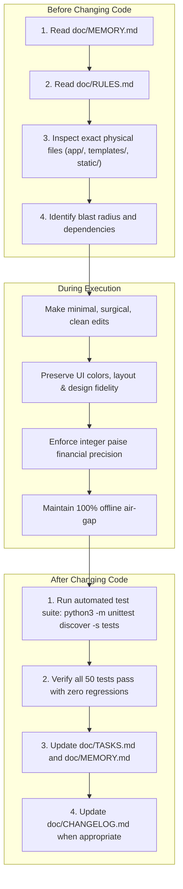

# MoneyTrack — Project Development Rules

**Document Version:** 1.0.0  
**Status:** Mandatory Standard  
**Applies To:** All Software Engineers, Contributors, and AI Coding Agents  
**Project:** MoneyTrack — Smart Financial Literacy and Budget Planner for Public  
**Core Requirement:** 100% Offline and Privacy-First  
**Target Repository Path:** `doc/RULES.md`  
**Current Release Version:** `v0.2.1-beta` (Git Commit: `c37a834`, Target: `v1.0.0 Stable`)  

---

## 1. General Development Principles

1. **100% Offline Sovereignty:** MoneyTrack must operate completely disconnected from the internet. Never introduce features, libraries, or scripts that require an active network connection.
2. **Zero-Knowledge Privacy:** The user's machine is the sole custodian of their financial records. Never transmit telemetry, crash reports, analytics, or user logs to remote endpoints.
3. **Layered Separation of Concerns:** Maintain a strict, unidirectional execution flow:
   $$\textbf{Frontend} \longrightarrow \textbf{Flask Routes} \longrightarrow \textbf{Services} \longrightarrow \textbf{Algorithms} \longrightarrow \textbf{Database Layer} \longrightarrow \textbf{SQLite}$$
   - Templates handle presentation, never business logic.
   - Routes handle HTTP requests/responses, never business operations.
   - Services handle business workflows, multi-account math, and transaction boundaries.
   - Algorithms execute deterministic financial math as pure functions.
   - Database Layer centralizes SQL execution and migrations.
4. **Deterministic Financial Accuracy:** Financial calculations must be mathematically exact, reproducible, and tested against standard banking formulae.
5. **No AI/ML Dependencies:** Do not introduce machine learning models, cloud generative AI APIs, or non-deterministic algorithms. Insights and diagnostics must remain rule-based and verifiable.
6. **Incremental & Non-Destructive Progression:** Never break working functionality. Every change must be backward-compatible and accompanied by verified tests.

---

## 2. Existing Project Preservation

1. **Protect Working Functionality:** Never remove, break, or disable existing features without explicit authorization from the project maintainer.
2. **Preserve Existing UI and Visual Identity (Mandatory UI Reference Rule):**
   - **Authoritative Visual Law:** The owner-provided MoneyTrack HTML sample (`sample_ui/MoneyTrack Financial Planner(DEMO).html` and `doc/references/moneytrack-ui-reference.html`) is the authoritative visual reference for the application's UI.
   - **Mandatory Pre-requisite:** Before creating or modifying any frontend component, inspect `doc/DESIGN.md` and follow the supplied UI reference.
   - **Invariant Design System Properties:** All existing and future screens must maintain the exact same:
     - Color palette (`#16A34A` brand greens, `#3B82F6` blue, `#8B5CF6` purple, `#F59E0B` amber, `#F43F5E` rose, slate neutrals).
     - Typography (clean compact sans-serif system stack).
     - Sidebar and navigation structure (`w-64` fixed desktop sidebar, mobile drawer).
     - Card design (`rounded-2xl`, subtle borders, soft drop shadows).
     - Border radius (`rounded-2xl` for cards, `rounded-xl` for inputs/buttons, `rounded-lg` for tabs).
     - Spacing (`p-4 sm:p-6 lg:p-8`).
     - Buttons (green primary buttons, small secondary action buttons).
     - Forms (rounded text/number inputs, custom select dropdowns, radio necessity pills).
     - Modals (accessible blurred backdrop, centered frame).
     - Chart presentation (SVG rings, Chart.js wrappers).
     - Dark and light themes (Slate-900 canvas vs Gray-50 canvas).
     - Responsive behaviour (desktop fixed sidebar, mobile slide-out drawer).
   - **Extension Without Invention:** New features must extend the existing design system, not introduce a new one.
   - **No Unauthorized Modernization:** Do not redesign, modernize, simplify, replace, or independently reinterpret the existing interface without explicit permission from the owner.
   - **Visual Invariance on Backend Refactoring:** Functional improvements must not cause unintended visual changes.
   - **Presentation vs. Data Separation:** The sample HTML defines visual presentation and interaction patterns only. Actual financial data must come from the Flask backend and SQLite database.
   - **Offline Asset Replacement:** The application must remain fully offline. Replace external CDN dependencies with local assets while preserving the same appearance.
   - **Design Conflict Escalation:** If a requested feature cannot fit the existing design, explain the issue and ask for approval before changing the design.
3. **File Safety:**
   - Do not delete, rename, or relocate existing files unless explicitly instructed.
   - Do not overwrite existing code unnecessarily. Always inspect before editing.
4. **Backward Compatibility:**
   - Preserve existing database schemas and user data.
   - Any schema modification must provide backward-compatible data migration routines.

---

## 3. Programming Language Standards

| Language / Domain | Standard & Version | Formatting & Linter Rules |
| :--- | :--- | :--- |
| **Python** | Python 3.10+ | PEP 8 compliance, 4 spaces indentation, strict type hints (`typing`), max line length 100 characters. |
| **JavaScript** | Modern ECMAScript (ES6+) | Standard syntax, 2 spaces indentation, camelCase variables/functions, strict semicolons. |
| **SQL** | ANSI SQL-92 / SQLite Dialect | Uppercase SQL keywords (`SELECT`, `INSERT`, `WHERE`), lowercase table/column names, snake_case identifiers. |
| **HTML / Jinja2** | HTML5 / Jinja2 3.x | Semantic HTML tags, lowercase element names, double-quoted attributes, Jinja blocks indented by 2 spaces. |
| **CSS** | Tailwind CSS 3.x (Local) | Utility-first classes matching prototype tokens, lowercase class names, no arbitrary unvetted styles. |

---

## 4. Python Coding Standards

1. **PEP 8 Compliance:** All Python source files must adhere strictly to PEP 8 standards.
2. **Strict Type Annotations:** Every function and method signature must include parameter type hints and explicit return types.
3. **Explicit Import Ordering:** Group imports logically in three distinct blocks separated by single blank lines:
   - Standard library imports (`import os`, `import sqlite3`, `from typing import Optional`).
   - Third-party package imports (`import flask`, `from flask import Blueprint, jsonify`).
   - Local application imports (`from app.services.financial_service import FinancialService`).
   - **Wildcard imports (`from module import *`) are strictly prohibited.**
4. **Docstring Standard:** Every module, class, service method, and algorithm function must have a concise docstring explaining purpose, inputs, outputs, and raised exceptions.
5. **No Mutable Default Arguments:** Never use mutable types (lists, dictionaries, sets) as default values in function definitions (`def fn(items=None):`).

---

## 5. Flask Development Rules

1. **Application Factory Pattern:** Application setup must reside in a factory function (`create_app(db_path=None)` in `app/__init__.py`). Never create a global mutable Flask instance.
2. **Blueprint Architecture:** Route endpoints must be organized into dedicated Flask Blueprints:
   - `views_bp` (`app/routes/views.py`): Serves complete Jinja2 HTML templates (`/` and `/report/monthly`).
   - `api_bp` (`app/routes/api.py`): Serves structured JSON responses (`/api/*`).
3. **Thin Route Handlers:** Routes are strictly controllers. They must:
   - Deserialize incoming HTTP headers, form inputs, or JSON payloads.
   - Perform initial parameter boundary checks.
   - Delegate immediately to the appropriate Service class.
   - Serialize the returned DTO into HTML or JSON with explicit HTTP status codes.
   - **Zero business logic, mathematical calculations, or direct SQL queries inside route functions.**
4. **No Logic Duplication:** Never duplicate business workflows across multiple routes. Extract shared logic into `FinancialService` or `CalculatorService`.
5. **Request-Scoped Database Lifecycle:** Database connections must bind cleanly to connection helpers and close cleanly on completion.

---

## 6. Database Development Rules

1. **Centralized Data Access:** Database operations must reside in `app/database/` and `app/services/`. Never write raw SQL strings inside route handlers or templates.
2. **Mandatory Foreign Key Enforcement:** SQLite connections must execute `PRAGMA foreign_keys = ON;` upon connection initialization.
3. **Zero Concatenated SQL (100% Parameterization):**
   ```python
   # Mandatory - Parameterized query
   cursor.execute("SELECT * FROM transactions WHERE profile_id = ? AND amount_paise >= ?", 
                  (profile_id, min_amt))

   # Prohibited - SQL injection vulnerability
   cursor.execute(f"SELECT * FROM transactions WHERE profile_id = {profile_id}")
   ```
4. **Performance PRAGMAs:**
   - Use Write-Ahead Logging: `PRAGMA journal_mode = WAL;`.
   - Set timeout: `sqlite3.connect(..., timeout=10.0)`.
5. **Database Transaction Boundaries:**
   - Any operation mutating multiple records or related tables must execute inside an explicit atomic transaction (`BEGIN IMMEDIATE` / `with conn:`).
6. **Schema Migrations:**
   - Schema modifications must preserve existing user records via non-destructive migrations (`ALTER TABLE ADD COLUMN` if not exists).

---

## 7. Financial Calculation Rules

1. **NEVER Use Floating-Point Arithmetic for Stored Monetary Amounts:**
   - Standard binary floating-point representation (`float`) causes catastrophic rounding drift.
2. **Store and Calculate in Integer Paise:**
   - **MANDATORY RULE:** All monetary amounts in database tables, runtime state arrays, and service calculations must be stored as **integer paise** ($1\text{ Rupee} = 100\text{ paise}$, `amount_paise INTEGER`).
   - Conversion to decimal Rupees ($₹$) must occur **strictly at the display boundary** (UI formatting in `app.js` or Jinja templates).
3. **Isolated Pure Algorithms:**
   - Mathematical engines (`app/services/calculator_service.py`) must be pure functions: inputs $\rightarrow$ outputs, zero side effects, zero I/O.
4. **No Hardcoded Baselines:**
   - Simulators and health scoring engines must calculate metrics against the user's actual real financial logs, never hardcoded dummy constants.

---

## 8. Frontend Development Rules

1. **Preserve Visual Reference:** The user interface must preserve the layout, styling, typography, colors, and responsive structures defined in `sample_ui/MoneyTrack Financial Planner(DEMO).html`.
2. **Zero Business Logic in Frontend:**
   - The frontend renders data provided by the server; it does not independently invent net worth or health scores.
3. **Responsive Viewport Support:**
   - All components must render cleanly on mobile viewports ($360\text{px}$ width) up to ultra-wide desktop monitors ($2560\text{px}$).
4. **Performance Target:**
   - Tab switching, modal displays, and filter changes must execute in $< 16\text{ms}$ (60 FPS rendering target).

---

## 9. JavaScript Rules

1. **Strict DOM XSS Prevention:**
   - **Never interpolate unescaped user strings directly into `innerHTML`.**
   - Always sanitize dynamic strings using `textContent`, DOM element construction, or an HTML entity encoding utility.
2. **No Unvetted External Scripts:** Do not load remote JavaScript from external hosts or public CDNs.
3. **Graceful Error Handling:** Wrap all asynchronous API calls in `try ... catch` blocks with user feedback.

---

## 10. Offline Development Requirements

1. **Air-Gap Verification:**
   - The application must start, operate, calculate, and render completely offline.
   - Tests and UI rendering must pass with all network adapters disabled.
2. **Local Asset Bundling:**
   - Every font, stylesheet, SVG icon, and JavaScript file must reside locally under `static/`.
   - Zero CDN script tags (`<script src="https://...">`) or external web fonts are permitted.
3. **No External API Dependencies:**
   - Do not integrate cloud banking aggregators (Plaid, Yodlee) or remote market tickers.

---

## 11. AI Coding Agent Instructions

Every AI coding agent operating in the MoneyTrack codebase must strictly follow these step-by-step instructions:



1. **Inspect Before Modifying:** Always inspect physical files on disk before proposing edits.
2. **Preserve Working Code:** Protect existing accounts, authentication, ledger, calculators, and reports.
3. **Verify Execution:** Always execute automated tests (`python3 -m unittest discover -s tests`). Never claim tests pass without running them.
4. **Update Documentation:** Keep `doc/` synchronized with actual implementation reality.
