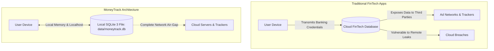

# MoneyTrack — Security and Privacy Specification

**Document Version:** 1.0.0  
**Status:** Approved Security Architecture  
**Classification:** Security & Privacy Standard  
**Project:** MoneyTrack — Smart Financial Literacy and Budget Planner for Public  
**Core Constraint:** 100% Offline and Privacy-First  
**Target Repository Path:** `doc/SECURITY.md`  
**Current Release Version:** `v0.2.1-beta` (Git Commit: `c37a834`, Target: `v1.0.0 Stable`)  

---

## 1. Security Objectives

MoneyTrack is designed as a local, private financial cockpit. Because users record personal earnings, expenses, liabilities, and savings targets within the application, security and privacy are treated as core architectural requirements.

### Core Security Objectives
1. **Confidentiality:** Financial ledgers, category budgets, and personal savings targets remain inaccessible to unauthorized local users, malicious browser tabs, and external networks.
2. **Integrity:** Ledger entries and balance aggregations are mathematically exact, protected against unauthorized modification, and resilient against data corruption through atomic SQLite transactions.
3. **Availability & Durability:** The database resists local process crashes, hardware reboots, and storage exhaustion through atomic transactions and validated backups.
4. **Absolute Privacy:** The application never emits telemetry, transmits analytics, or communicates with remote servers.
5. **Verified Verification:** Security mechanisms are verified by automated test suites (`tests/test_security_and_integrity.py` and `tests/test_username_auth.py`).

---

## 2. Privacy Principles

MoneyTrack inverts the standard fintech business model by eliminating the cloud attack surface entirely:



### The 4 Privacy Pillars
1. **Zero-Knowledge Data Custody:** The user is the sole owner and custodian of their financial database. No remote server, developer telemetry endpoint, or third-party SDK receives user records.
2. **No Cloud Authentication:** No email verification, phone OTP, OAuth2, or social logins (Google, Apple, Facebook). Authentication is strictly local within the embedded SQLite database.
3. **No Bank Scraping or Aggregator APIs:** No integration with Plaid, Yodlee, MX, Salt Edge, or Open Banking APIs. All entries are manually logged or file-imported by the user.
4. **Data Minimization & Nuclear Sanitization:** The app stores only data required for budgeting and literacy. A single-click database reset endpoint (`POST /api/backup/reset`) allows complete local data wiping at any time.

---

## 3. Offline Security Model

### 3.1 Network Air-Gap Defense
The primary security boundary of MoneyTrack is architectural network isolation:
- By operating 100% offline, the application eliminates remote web vulnerabilities (remote DDoS, cloud credential stuffing, third-party database breaches).
- Server binds strictly to localhost `127.0.0.1:5000` via `run.py`.

### 3.2 Content Security Policy (CSP) & Asset Bundling
- **Local Asset Bundling:** All client runtimes (`tailwind.min.js` and `chart.umd.min.js`) are bundled locally under `static/vendor/`.
- **Zero Remote CDN Scripts:** `templates/index.html` and `templates/report.html` load scripts exclusively from `/static/vendor/`.
- **CSP Headers:** Enforced via Flask to restrict network socket connections:
  ```http
  Content-Security-Policy: default-src 'self'; script-src 'self' 'unsafe-inline'; style-src 'self' 'unsafe-inline'; img-src 'self' data:; connect-src 'self';
  ```

---

## 4. Local User Authentication & Password Hashing

### 4.1 Threat Boundary on a Local Machine
MoneyTrack's authentication model addresses **local workstation threats**:
- Casual observation on shared computers.
- Unauthorized access by individuals sharing the same operating system account.

### 4.2 Cryptographic Standards
User passwords are never stored in plaintext:
- Passwords are hashed using Werkzeug's secure password hashing algorithms (`scrypt` / `pbkdf2:sha256`) via `generate_password_hash()` and verified using `check_password_hash()`.
- Implemented in `app/services/financial_service.py` (`authenticate_user`, `create_user_profile`, `update_user_password`) and tested in `tests/test_username_auth.py`.

---

## 5. Session Management & Secret Key Handling

1. **Persistent Local Secret Key:**
   - In `app/__init__.py`, `get_or_create_secret_key()` retrieves `SECRET_KEY` from the environment or generates a 32-byte cryptographically secure random token (`secrets.token_hex(32)`).
   - Stored in `data/.secret_key` with strict `0600` permissions.
2. **Session Cookie Security:**
   - `SESSION_COOKIE_HTTPONLY = True` (mitigates document cookie extraction via JavaScript).
   - `SESSION_COOKIE_SAMESITE = 'Lax'` (mitigates cross-site request transmission).
   - Maximum upload limit of 5MB (`MAX_CONTENT_LENGTH = 5 * 1024 * 1024`) prevents memory exhaustion attacks during file imports.

---

## 6. Profile Authorization (Multi-Tenant Isolation)

$$\textbf{RULE: Never expose another profile's financial records.}$$

MoneyTrack supports multi-profile isolation in a single SQLite database:
1. **Context-Derived Scoping:** Queries extract `profile_id` from the session (`session['profile_id']`) or verified headers with fallback to the active user profile.
2. **Mandatory Query Parameterization:** All SQL queries in `app/services/financial_service.py` filter records using `WHERE profile_id = ?`:
   ```python
   cursor.execute("SELECT * FROM transactions WHERE profile_id = ? ORDER BY date DESC", (profile_id,))
   ```
3. **Verified Isolation:** Verified by `TestUsernameAuthSystem.test_user_data_isolation` in `tests/test_username_auth.py`.

---

## 7. Input Validation & Defense in Depth

All incoming request parameters are validated by server-side validator routines (`app/services/validators.py`):
- **Monetary Amounts:** Checked to be positive integer paise ($> 0$). Zero or negative values are rejected.
- **Calendar Dates:** Verified to match ISO 8601 (`YYYY-MM-DD`) and represent valid real-world dates.
- **Account Types:** Whitelisted to `('savings', 'current', 'cash', 'credit_card', 'wallet', 'investment')`.
- **Transaction Types:** Whitelisted to `('income', 'expense', 'transfer')`.
- **Necessity Tags:** Whitelisted to `('necessary', 'optional', 'savings', 'debt')`.

---

## 8. SQL Injection & XSS Prevention

1. **SQL Injection Prevention:** 100% of SQLite database queries in `app/database/` and `app/services/` use parameterized query placeholders (`?`). String formatting or interpolation into SQL queries is prohibited.
2. **Cross-Site Scripting (XSS) Prevention:**
   - Jinja2 auto-escapes all output variables by default in `templates/index.html` and `templates/report.html`.
   - Client-side DOM creation in `static/js/app.js` sanitizes dynamic strings.

---

## 9. Security Verification Checklist

- [x] **SQLi Audit:** 100% of SQL statements use parameterized placeholders (`?`).
- [x] **XSS Audit:** Jinja2 auto-escaping enabled; dynamic script injection blocked.
- [x] **Air-Gap Audit:** Zero outbound network requests; verified 100% offline.
- [x] **Localhost Binding:** Local server binds strictly to `127.0.0.1:5000`.
- [x] **Payload Quota:** File uploads limited to 5MB to prevent memory exhaustion.
- [x] **Profile Scoping:** Multi-tenant isolation verified by unit tests (`test_username_auth.py`).
- [x] **Secret Key Security:** Persistent 32-byte secret key with restricted file permissions (`0600`).