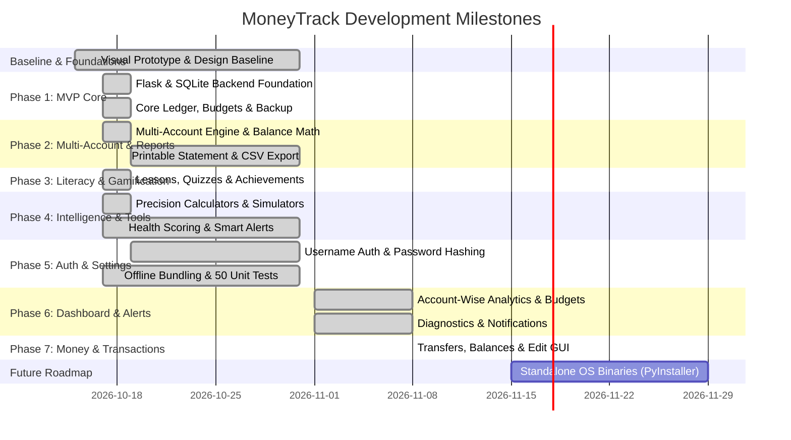

# MoneyTrack — Development Roadmap & Master Task Checklist

**Document Version:** 1.0.0  
**Status:** Active Engineering Roadmap & Implementation Tracker  
**Project:** MoneyTrack — Smart Financial Literacy and Budget Planner for Public  
**Core Requirement:** 100% Offline and Privacy-First  
**Target Repository Path:** `doc/TASKS.md`  
**Current Release Version:** `v0.8.1-beta` 
**Test Suite Status:** 65/65 Tests Passing (`python3 -m unittest discover -s tests`)  

---

## Roadmap Overview & Progress Dashboard

MoneyTrack's development is organized into sequential engineering phases. All tasks adhere to the architectural rules in [`doc/ARCHITECTURE.md`](file:///home/prajwal/College%20Work/PROJECT/Smart%20Financial%20Literacy%20and%20Budget%20Planner%20for%20Public/doc/ARCHITECTURE.md), development standards in [`doc/RULES.md`](file:///home/prajwal/College%20Work/PROJECT/Smart%20Financial%20Literacy%20and%20Budget%20Planner%20for%20Public/doc/RULES.md), and UI specifications in [`doc/DESIGN.md`](file:///home/prajwal/College%20Work/PROJECT/Smart%20Financial%20Literacy%20and%20Budget%20Planner%20for%20Public/doc/DESIGN.md).

### Milestone Progress Summary

| Phase | Focus Area | Status | Verification & Ground Truth |
| :--- | :--- | :--- | :--- |
| **Phase 0** | Baseline Specification & Prototype | **Completed (100%)** | `sample_ui/MoneyTrack Financial Planner(DEMO).html` and specification suite in `doc/`. |
| **Phase 1** | MVP Core (Flask, SQLite, Ledger, Budgets) | **Completed (100%)** | `app/database/`, `app/routes/api.py`, `app/services/financial_service.py`. |
| **Phase 2** | Multi-Account System & Statements | **Completed (100%)** | 6 account types (Assets vs Liabilities), `templates/report.html`, CSV export. |
| **Phase 3** | Financial Literacy & Gamification | **Completed (100%)** | Lessons curriculum, interactive quizzes with feedback, achievement catalog. |
| **Phase 4** | Financial Calculators & Intelligence | **Completed (100%)** | Reducing-balance EMI, CI, Inflation, Affordability Evaluator, Health Score (0–100). |
| **Phase 5** | Authentication, Settings & Air-Gap | **Completed (100%)** | Multi-profile username authentication, password hashing, local vendor bundling. |
| **Phase 6** | Dashboard Analytics, Budget Limits, Alerts & Diagnostics | **Completed (100%)** | Account-wise filtering, Budget Manager Modal, Dynamic Insights, 5-point Diagnostics, Toast Stack. |
| **Phase 7** | Money & Transactions Management | **Completed (100%)** | Account creation guard, wallet-to-wallet transfers, opening balance accuracy, custom transaction edit GUI, 65/65 tests passing. |
| **Backlog** | Standalone Desktop Packaging | **Planned** | Standalone PyInstaller / AppImage distribution. |

---

## Phase 0: Baseline Specification & Prototype (Completed)

- [x] **TASK-001: Authoritative Visual Prototype**
  - **Description:** Implement single-page interactive HTML visual prototype demonstrating all 9 core views, theme switching, and local storage state.
  - **Verification:** Verified in `sample_ui/MoneyTrack Financial Planner(DEMO).html` and `doc/references/moneytrack-ui-reference.html`.
- [x] **TASK-002: Product Requirements Document (PRD)**
  - **Description:** Document all required product specification sections, feature lifecycles, and non-advisory disclaimers.
  - **Verification:** Verified in `doc/PRD.md`.
- [x] **TASK-003: Project Inspection & Codebase Audit**
  - **Description:** Perform complete codebase inspection, audit ground truth versus planned architecture, and document reality.
  - **Verification:** Verified in `doc/PROJECT_AUDIT.md`.
- [x] **TASK-004: System Architecture Specification**
  - **Description:** Define multi-tier layered architecture (Frontend $\rightarrow$ Routes $\rightarrow$ Services $\rightarrow$ Database $\rightarrow$ SQLite).
  - **Verification:** Verified in `doc/ARCHITECTURE.md`.
- [x] **TASK-005: Project Development Rules**
  - **Description:** Establish mandatory coding standards, integer paise financial rules, and AI coding agent protocols.
  - **Verification:** Verified in `doc/RULES.md`.
- [x] **TASK-006: UI/UX Design System Specification**
  - **Description:** Document complete color palette, typography, layout, screen-by-screen specs, and UI consistency rules.
  - **Verification:** Verified in `doc/DESIGN.md`.
- [x] **TASK-007: Development Roadmap & Master Task Checklist**
  - **Description:** Structure all milestones into verifiable engineering tasks.
  - **Verification:** Verified in `doc/TASKS.md`.
- [x] **TASK-008: Persistent AI Context & Project Memory Anchor**
  - **Description:** Document persistent operational context, constraints, and instructions for AI coding agents.
  - **Verification:** Verified in `doc/MEMORY.md`.
- [x] **TASK-009: Database Architecture & Relational Schema Specification**
  - **Description:** Document SQLite configuration, DDL, table definitions, integer paise storage, and ER diagrams.
  - **Verification:** Verified in `doc/DATABASE.md`.
- [x] **TASK-010: Comprehensive Testing Strategy & Financial Verification**
  - **Description:** Establish automated test strategy, coverage matrix, and financial verification standards.
  - **Verification:** Verified in `doc/TESTING.md`.
- [x] **TASK-011: Security and Privacy Requirements Specification**
  - **Description:** Define privacy-first offline security architecture, air-gap controls, and threat model.
  - **Verification:** Verified in `doc/SECURITY.md`.
- [x] **TASK-012: Project Change History & Keep a Changelog Setup**
  - **Description:** Establish project change history adhering to Keep a Changelog and Semantic Versioning standards.
  - **Verification:** Verified in `doc/CHANGELOG.md`.

---

## Phase 1 — MVP (Minimum Viable Product) Core (Completed)

### 1.1 Database & Connection Lifecycle
- [x] **TASK-101: SQLite Database Engine & Connection Lifecycle**
  - **Description:** Implement `app/database/connection.py` managing SQLite connections with WAL mode, foreign key enforcement (`PRAGMA foreign_keys = ON;`), and non-destructive migrations.
  - **Verification:** Verified in `app/database/connection.py` and `tests/test_api.py`.
- [x] **TASK-102: User Profile Repository & Default Sandbox**
  - **Description:** Implement `user_profiles` table schema and default profile initialization with currency support.
  - **Verification:** Verified in `app/database/schema.sql` and `app/services/financial_service.py`.
- [x] **TASK-103: Account Balance Aggregation Service**
  - **Description:** Implement `FinancialService.get_ledger_totals()` and multi-account balance math in integer paise.
  - **Verification:** Verified in `app/services/financial_service.py` and `tests/test_financial_service.py`.

### 1.2 Income & Expense Management
- [x] **TASK-104: Integer Paise Transaction Schema & DDL**
  - **Description:** Define `transactions` table with `amount_paise INTEGER NOT NULL`, `type CHECK IN ('income', 'expense', 'transfer')`, and `type_tag CHECK IN ('necessary', 'optional', 'savings', 'debt')`.
  - **Verification:** Verified in `app/database/schema.sql` and `tests/test_security_and_integrity.py`.
- [x] **TASK-105: Income & Expense Recording Workflow**
  - **Description:** Implement `POST /api/transactions` and UI modal handling transaction insertion and balance updates.
  - **Verification:** Verified in `app/routes/api.py` and `static/js/app.js`.
- [x] **TASK-106: Transaction Deletion with Balance Recalculation**
  - **Description:** Implement `DELETE /api/transactions/<id>` and UI removal trigger.
  - **Verification:** Verified in `app/routes/api.py` and `tests/test_api.py`.
- [x] **TASK-107: Transaction Ledger Table Filtering & Search**
  - **Description:** Implement real-time client-side and server-side filtering by Type, Category, Account, and search query.
  - **Verification:** Verified in `static/js/app.js` and `app/services/financial_service.py`.

### 1.3 Categories & Internal Transfers
- [x] **TASK-108: Default Category Taxonomy**
  - **Description:** Provision initial seeded categories (`Food & Dining`, `Transport`, `Shopping`, `Bills & Utilities`, `Salary`, `Other`, `Transfer`).
  - **Verification:** Verified in `seed_catalog_data` in `app/database/connection.py`.
- [x] **TASK-109: Account Internal Transfer Mechanism**
  - **Description:** Implement internal transfer transaction allocating funds between accounts with `destination_account_id`.
  - **Verification:** Verified in `app/services/financial_service.py` and `tests/test_accounts.py`.

### 1.4 Budget Management
- [x] **TASK-110: Category Budget Schema & Repository**
  - **Description:** Define `budgets` table tracking monthly category spending ceilings in integer paise (`monthly_limit_paise`).
  - **Verification:** Verified in `app/database/schema.sql` with unique constraint `(profile_id, category_id, month_year)`.
- [x] **TASK-111: Dynamic Budget Tracking & Alert Evaluation**
  - **Description:** Implement `FinancialService.get_budget_overview()` calculating spending percentages and threshold alerts.
  - **Verification:** Verified in `app/services/financial_service.py` and `tests/test_financial_service.py`.

### 1.5 Savings Goals
- [x] **TASK-112: Savings Goal CRUD & Schema**
  - **Description:** Define `savings_goals` table with `target_amount_paise`, `current_amount_paise`, target dates, and statuses.
  - **Verification:** Verified in `app/database/schema.sql` and `app/services/financial_service.py`.
- [x] **TASK-113: One-Click Quick Deposit & Withdrawal**
  - **Description:** Implement `POST /api/goals/<id>/deposit` and `POST /api/goals/<id>/withdraw` with overdraft protection.
  - **Verification:** Verified in `app/routes/api.py` and `tests/test_api.py`.

### 1.6 Dashboard, Analytics & Backup
- [x] **TASK-114: Dashboard KPI Summary Widget**
  - **Description:** Render 4 KPI cards (Total Income, Total Expenses, Net Savings, Net Cash Balance) with dynamic values.
  - **Verification:** Verified in `app/routes/api.py` (`/api/dashboard`) and `templates/index.html`.
- [x] **TASK-115: Category Spending Distribution (Donut Chart)**
  - **Description:** Render SVG donut chart and Chart.js category spending widgets dynamically.
  - **Verification:** Verified in `static/js/app.js` and `templates/index.html`.
- [x] **TASK-116: 50/30/20 Spending Ratios**
  - **Description:** Aggregate expenses by `necessary` (Needs), `optional` (Wants), and savings in integer paise.
  - **Verification:** Verified in `FinancialService.get_spending_by_necessity()`.
- [x] **TASK-117: Single-Click JSON Backup Exporter**
  - **Description:** Implement `GET /api/settings/export/json` generating complete state backup with accounts and budgets.
  - **Verification:** Verified in `app/services/backup_service.py` and `tests/test_api.py`.
- [x] **TASK-118: Schema-Validated JSON Backup Restorer**
  - **Description:** Implement `POST /api/settings/import/json` validating schema structure and restoring records atomically.
  - **Verification:** Verified in `app/services/backup_service.py` and `tests/test_api.py`.
- [x] **TASK-119: Local Database Reset ("Nuclear Reset")**
  - **Description:** Implement confirmation trigger and endpoint `POST /api/backup/reset` to reset database to initial baseline.
  - **Verification:** Verified in `app/routes/api.py` and `static/js/app.js`.

---

## Phase 2 — Multi-Account System, Cashflow & Reports (Completed)

- [x] **TASK-201: Multi-Account Type Engine**
  - **Description:** Support 6 account types (`savings`, `current`, `cash`, `credit_card`, `wallet`, `investment`) with initial balance and color/icon customization.
  - **Verification:** Verified in `app/database/schema.sql`, `app/services/financial_service.py`, and `tests/test_accounts.py`.
- [x] **TASK-202: Asset vs. Liability Balance Calculations**
  - **Description:** Distinct balance math for Assets (Inflows - Outflows) vs Liabilities (Credit Cards: Outflows - Inflows).
  - **Verification:** Verified in `tests/test_accounts.py` (8 passing tests).
- [x] **TASK-203: Cascade Account Deletion Safety**
  - **Description:** Deleting an account executes `ON DELETE SET NULL` on transactions, preserving ledger integrity.
  - **Verification:** Verified in `tests/test_accounts.py`.
- [x] **TASK-204: Future Cash Flow Calendar & Bill Reminders**
  - **Description:** Define `calendar_events` table for scheduled obligations with frequencies (`once`, `weekly`, `monthly`, `yearly`) and dashboard alerts for upcoming bills within 7 days.
  - **Verification:** Verified in `app/services/financial_service.py` and `/api/dashboard`.
- [x] **TASK-205: CSV Ledger Export**
  - **Description:** Downloadable `.csv` export endpoint (`/api/settings/export/csv`) formatted with dates, accounts, categories, types, and amounts.
  - **Verification:** Verified in `app/services/backup_service.py` and `tests/test_api.py`.
- [x] **TASK-206: Printable Monthly Financial Statement / PDF**
  - **Description:** Formatted printer-ready HTML report endpoint (`/report/monthly`) optimized for paper and browser "Save as PDF".
  - **Verification:** Verified in `app/routes/views.py` and `templates/report.html`.

---

## Phase 3 — Financial Literacy & Interactive Learning (Completed)

- [x] **TASK-301: Lesson Curriculum Schema & Seed Manager**
  - **Description:** Define `lessons` table pre-seeded with beginner lessons on Budgeting (50/30/20 Rule), Debt Management, and Compound Interest vs Inflation.
  - **Verification:** Verified in `app/services/learning_service.py` and `app/database/connection.py`.
- [x] **TASK-302: Interactive Quiz Engine with Instant Feedback**
  - **Description:** Multiple-choice quiz questions with instant scoring, correct answer reveals, and detailed explanations.
  - **Verification:** Verified in `app/routes/api.py` (`/api/learning/quizzes/submit`) and `static/js/app.js`.
- [x] **TASK-303: User Quiz Performance Persistence**
  - **Description:** Track user quiz scores in `user_quiz_results` SQLite table per profile.
  - **Verification:** Verified in `app/database/schema.sql` and `app/services/learning_service.py`.
- [x] **TASK-304: Gamified Achievements Catalog**
  - **Description:** Unlocked badge system tracking milestones (`First Entry`, `Budget Master`, `Goal Setter`, `Financial Scholar`).
  - **Verification:** Verified in `achievements` and `user_achievements` tables.

---

## Phase 4 — Financial Calculators & Intelligence (Completed)

- [x] **TASK-401: Reducing-Balance Loan EMI Calculator**
  - **Description:** Exact actuarial EMI and total interest calculation using standard banking formula.
  - **Verification:** Verified in `app/services/calculator_service.py` and `tests/test_calculators.py`.
- [x] **TASK-402: Compound Interest Calculator**
  - **Description:** Compound interest projections supporting customizable compounding frequencies and tenures.
  - **Verification:** Verified in `app/services/calculator_service.py` and `tests/test_calculators.py`.
- [x] **TASK-403: Inflation & Purchasing Power Calculator**
  - **Description:** Future cost and purchasing power erosion projections over configurable inflation rates and years.
  - **Verification:** Verified in `app/services/calculator_service.py` and `tests/test_calculators.py`.
- [x] **TASK-404: Purchase Affordability Evaluator ("Can I Afford This?")**
  - **Description:** Evaluates purchase price against liquid reserves and checks remaining emergency runway in months.
  - **Verification:** Verified in `app/services/calculator_service.py` and `tests/test_api.py`.
- [x] **TASK-405: What-If Scenario Simulator**
  - **Description:** Dynamic forward-looking scenario modeling the impact of salary changes and expense reductions on net annual savings.
  - **Verification:** Verified in `FinancialService.simulate_scenario()` and `static/js/app.js`.
- [x] **TASK-406: 3-Pillar Financial Health Score Engine (0–100)**
  - **Description:** Dynamic scoring evaluating Savings Rate (40%), Budget Discipline (35%), and Emergency Reserve Runway (25%). Strictly defaults to 0 on empty profiles.
  - **Verification:** Verified in `FinancialService.calculate_health_score()` and `tests/test_security_and_integrity.py`.

---

## Phase 5 — Authentication, Air-Gap & Quality Assurance (Completed)

- [x] **TASK-501: Multi-User Username & Password Authentication System**
  - **Description:** Secure multi-profile authentication using Werkzeug password hashing, session cookies, and login/register endpoints.
  - **Verification:** Verified in `tests/test_username_auth.py` (8 passing tests).
- [x] **TASK-502: Profile Data Isolation**
  - **Description:** Strict multi-tenant scoping (`profile_id = ?`) ensuring no data crossover between distinct local user profiles.
  - **Verification:** Verified in `tests/test_username_auth.py`.
- [x] **TASK-503: 100% Offline Air-Gap Verification**
  - **Description:** Pre-packaged local `static/vendor/tailwind.min.js`, `static/vendor/chart.umd.min.js`, and offline Python package distribution in `vendor/`.
  - **Verification:** Verified in `templates/index.html` and `app/__init__.py`.
- [x] **TASK-504: Comprehensive Test Suite (57 Tests, 100% Pass)**
  - **Description:** Complete automated test suite covering accounts, API, calculators, E2E workflows, financial service, security, authentication, and dashboard analytics/alerts.
  - **Verification:** Verified via `python3 -m unittest discover -s tests` (Ran 57 tests, OK).

---

## Phase 6 — Dashboard Account-Wise Analytics, Category Budget Management, Real-Time Alerts & Diagnostics (Completed)

- [x] **TASK-601: Account-Wise & Wallet-Wise Financial Dashboard Data**
  - **Description:** Scoped financial summary generation per account/wallet (inflows, outflows, balance, savings rate) with visual switcher pills and accounts breakdown grid; clearly labels Primary account.
  - **Verification:** Verified in `app/services/financial_service.py` (`get_ledger_totals`, `get_accounts`) and `tests/test_dashboard_analytics_and_alerts.py`.
- [x] **TASK-602: Account-Specific Health Score & Visualizations**
  - **Description:** Scopes Health Score (0–100, 3 pillars) and Category Spending SVG donut chart strictly to the selected account without mixing funds from other accounts.
  - **Verification:** Verified in `app/services/financial_service.py` (`calculate_health_score`, `get_category_spending`) and `tests/test_dashboard_analytics_and_alerts.py`.
- [x] **TASK-603: Category Budget Limits Management Interface**
  - **Description:** Dedicated Category Budget Management modal (`#budget-manager-modal`) enabling creating, updating, and deleting monthly category spending limits with real-time spent, remaining, and percentage progress bars.
  - **Verification:** Verified in `templates/index.html`, `static/js/app.js` (`openBudgetManagerModal`, `handleSaveBudget`, `deleteBudget`), and `app/routes/api.py`.
- [x] **TASK-604: Responsive Category Spending Breakdown Layout & Label Wrapping**
  - **Description:** Moved top category labels cleanly below the donut chart with full word-wrapping (`break-words`), eliminating SVG center text clipping and overflow.
  - **Verification:** Verified in `templates/index.html` and `static/js/app.js`.
- [x] **TASK-605: Dynamic English Spending Insights Engine**
  - **Description:** Deterministic month-over-month category variance analysis highlighting spending surges, drops, and large individual purchases (> ₹5,000) using plain English.
  - **Verification:** Verified in `FinancialService.generate_spending_insights()` and `tests/test_dashboard_analytics_and_alerts.py`.
- [x] **TASK-606: Real-Time Financial Alerts & Warning System**
  - **Description:** Live database state evaluation checking budget overruns (>100%), threshold warnings (>=85%), low account balances (< ₹1,000), credit card balances, and upcoming bills. Deduplicated alert records with dismiss controls.
  - **Verification:** Verified in `FinancialService.get_financial_alerts()` and `tests/test_dashboard_analytics_and_alerts.py`.
- [x] **TASK-607: Live System Diagnostics & Background Tab Notifications**
  - **Description:** 5-point database integrity diagnostics engine (ledger consistency, transaction references, category budget bounds, account configuration, and SQLite WAL/FK status). Client toast notification stack and `document.hidden` tab notification integration.
  - **Verification:** Verified in `FinancialService.run_system_diagnostics()`, `GET /api/diagnostics`, `static/js/app.js`, and `tests/test_dashboard_analytics_and_alerts.py`.

---

## Phase 7 — Money & Transactions: Account Transfers, Opening Balance & Complete Transaction Management (Completed)

- [x] **TASK-701: Account & Wallet Creation Requirement for Income & Expense**
  - **Description:** Enforces that users must have at least one account/wallet before adding income or expenses. Disables/warns in UI via `#account-required-modal` and `#tx-no-account-warning`, and rejects unassociated transaction creation at API level (HTTP 400).
  - **Verification:** Verified in `app/routes/api.py`, `static/js/app.js`, `templates/index.html`, and `tests/test_money_and_transactions.py`.
- [x] **TASK-702: Account & Wallet-to-Wallet Money Transfers**
  - **Description:** Direct fund transfers across all account/wallet pairs (Account↔Account, Account↔Wallet, Wallet↔Wallet). Validates source != destination, amount > 0, source balance sufficiency, executes atomically within SQLite transaction, and immediately updates balances.
  - **Verification:** Verified in `FinancialService.transfer_funds()`, `app/routes/api.py`, `static/js/app.js`, and `tests/test_money_and_transactions.py`.
- [x] **TASK-703: Display Transfers in Transaction History & Dedicated Filter Tab**
  - **Description:** Distinguishable display of transfers in transaction history table with Source $\rightarrow$ Destination routing, Transfer In vs Transfer Out context based on active account filter, dedicated "Transfers" filter tab, and exclusion of transfers from regular income/expense aggregations.
  - **Verification:** Verified in `FinancialService.get_transactions()`, `FinancialService.get_ledger_totals()`, `templates/index.html`, and `static/js/app.js`.
- [x] **TASK-704: Opening Balance Mathematical Consistency & Liability Tracking**
  - **Description:** Mathematical audit of opening balances (`initial_balance_paise`). Verified that initial balances reflect immediately upon creation, are not treated as fees or regular income, are not double-counted, and correctly integrate with Credit Card liabilities (`initial_paise + (charges - payments)`).
  - **Verification:** Verified in `FinancialService.get_accounts()`, `FinancialService.get_ledger_totals()`, and `tests/test_money_and_transactions.py`.
- [x] **TASK-705: Fix `FinancialService.update_transaction()` Argument Mismatch**
  - **Description:** Resolved runtime `TypeError: FinancialService.update_transaction() got an unexpected keyword argument 'tx_id'` by aligning function signatures across `api.py` and `financial_service.py` to seamlessly accept `tx_id` and `transaction_id`.
  - **Verification:** Verified in `FinancialService.update_transaction()` and `tests/test_money_and_transactions.py`.
- [x] **TASK-706: Remove Necessity Classification from Add Income Flow**
  - **Description:** Removed necessity classification radio buttons from Add Income modal while cleanly preserving necessity classification for Add Expense. Server-side automatically defaults income transactions to `'necessary'` tag.
  - **Verification:** Verified in `templates/index.html`, `static/js/app.js`, `app/routes/api.py`, and `tests/test_money_and_transactions.py`.
- [x] **TASK-707: Enhanced "+ New Account" Button UI & Quick Transfer Triggers**
  - **Description:** Cleaned up "+ New Account" button styling, removed duplicate "+ +" labels, added dedicated Transfer and New Account action buttons in the Accounts & Wallets section header, and added per-account quick transfer action shortcuts.
  - **Verification:** Verified in `templates/index.html` and `static/js/app.js`.
- [x] **TASK-708: Context-Aware Form Placeholders for Income and Expense**
  - **Description:** Dynamic, context-sensitive form placeholders tailored specifically for Income (e.g., Salary, Freelance project) versus Expense (e.g., Grocery shopping, Electricity bill) with appropriate category and amount hints.
  - **Verification:** Verified in `static/js/app.js` (`openAddTransactionModal`).
- [x] **TASK-709: Complete Custom GUI Transaction Editor Modal**
  - **Description:** Custom modal GUI (`#edit-tx-modal`) allowing users to edit every transaction field (Amount, Description, Category, Account, Destination Account for transfers, Date, and Expense Necessity tag). Atomically reverses old balance impacts and applies new updates without browser native prompts.
  - **Verification:** Verified in `templates/index.html`, `static/js/app.js`, `FinancialService.update_transaction()`, and `tests/test_money_and_transactions.py`.
- [x] **TASK-710: Dedicated Money & Transactions Automated Test Suite (65/65 Tests Passing)**
  - **Description:** Implemented comprehensive automated test suite `tests/test_money_and_transactions.py` covering all 8 core feature areas, achieving 65/65 passing tests across the entire codebase.
  - **Verification:** Verified via `python3 -m unittest discover -s tests`.

---

## Phase 8 — Future Packaging & Distribution (Planned)

- [ ] **TASK-801: PyInstaller Standalone Windows Executable**
  - **Description:** Package MoneyTrack as a single-file portable `.exe` bundle for offline Windows execution.
  - **Priority:** Medium
  - **Dependencies:** None (App is fully functional via `python run.py`).
- [ ] **TASK-802: Linux AppImage / Debian Package**
  - **Description:** Package MoneyTrack with desktop launcher integration for Linux workstations.
  - **Priority:** Medium
  - **Dependencies:** None.
